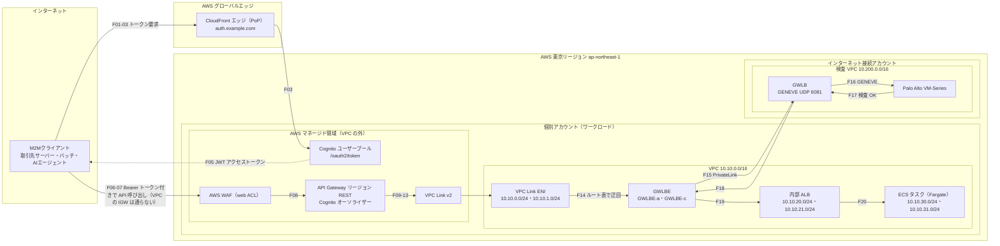
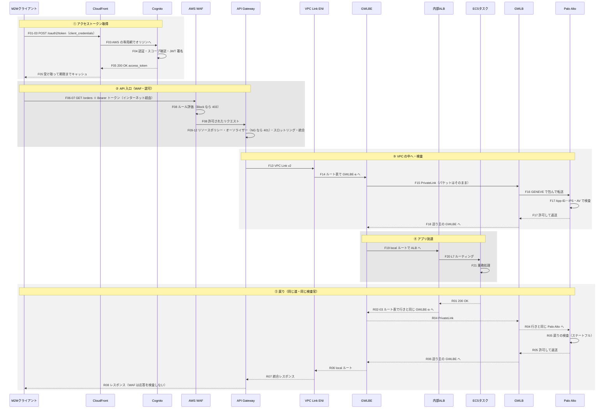

# AWS M2M 認証 × API 通信フロー 完全ガイド

> CloudFront → Cognito（アクセストークン取得）→ リージョン API Gateway（WAF・Cognito オーソライザー）→ VPC Link v2 → GWLBE／GWLB（Palo Alto）で検査 → ALB → ECS、そして戻りの道  
> 動作原理・動作イメージ・歴史と背景を、「小学生にもわかるたとえ話」と「技術の詳細」の二段構えで解説

| 項目 | 内容 |
|---|---|
| 文書名 | AWS M2M 認証 × API 通信フロー 完全ガイド（CloudFront／Cognito／API Gateway／WAF／VPC Link v2／GWLB・Palo Alto／ALB／ECS） |
| 版 | 1.0 |
| 作成日 | 2026年10月3日 |
| 情報の基準 | 2026年10月3日時点で確認できた公開情報（AWS 公式ドキュメント、What's New、AWS ブログ、Palo Alto Networks 公式ドキュメントなど。「15_参考資料」を参照） |
| 想定読者 | 設計者・運用者・セキュリティ担当者、はじめて学ぶ方（小学生向けのたとえ話つき） |
| 前提の構成（例） | リージョン：東京（ap-northeast-1）／個別アカウント VPC：10.10.0.0/16（AZ-a・AZ-c）／インターネット接続アカウントの検査 VPC：10.200.0.0/16／トークン用ドメイン：auth.example.com／API 用ドメイン：api.example.com／スコープ：orders-api/read |
| 出力ファイル | Markdown（本書）と Excel（同じ内容。セル書式つき） |

**表記ルール**：F01〜F21 ＝ 行き（リクエスト）のステップ番号　／　R01〜R09 ＝ 戻り（レスポンス）のステップ番号　／　★ ＝ 特に重要なポイント　／　※ ＝ 補足・注意　／　たとえ ＝ 小学生向けのたとえ話（「ロボくんのおつかい大冒険」）　／　例の値 ＝ IP アドレス・ID・ドメインはすべて説明用の例です

## 目次

- 0. 3 行でいうと
- 1. 全体構成図
- 2. 動作イメージ（シーケンス図）
- 3. 小学生向けストーリー「ロボくんのおつかい大冒険」
- 4. 行きの通信フロー詳細（F01〜F21）
- 5. 戻りの通信フロー詳細（R01〜R09）
- 6. パケットの変化
- 7. 動作原理の深掘り（コンポーネント別）
- 8. ルートテーブル・SG・GWLB の設計例
- 9. 多層防御
- 10. 歴史と背景・必要になった経緯
- 11. 設計・運用の注意点
- 12. トラブル早見表
- 13. よくある質問（FAQ）
- 14. 用語集
- 15. 参考資料
- ご注意

## 0. 3 行でいうと

1. ロボット（M2M クライアント）は、まず近くの CloudFront エッジ経由で Cognito から「1 時間有効・権限付き・偽造できない通行証（JWT アクセストークン）」をもらう。
2. 通行証を持ってインターネット経由で東京リージョンの API Gateway へ。WAF が危険物を検査し、Cognito オーソライザーが通行証を検証。合格なら VPC Link v2 で VPC の中へ（個別アカウント VPC の IGW は通らない）。
3. VPC の中では、ルートテーブルの指示で GWLBE →（別アカウントの）GWLB → Palo Alto で検査し、合格した通信だけが ALB → ECS タスクに届く。返事も「同じ道・同じ検査官」を逆にたどって戻る。

## 1. 全体構成図

### 1-1. 構成図（Mermaid）

GitHub や VS Code の Markdown プレビューなど、Mermaid に対応した表示環境で図として表示されます。



### 1-2. 構成図（テキスト版。Mermaid が表示できない環境向け）

```text
 [Internet]              [AWS Global Edge]             [AWS Tokyo Region ap-northeast-1]
 +-------------+  F01-03  +-------------------+  F03   +--------------------------------------+
 |             |--------->| CloudFront (PoP)  |------->| Cognito User Pool  /oauth2/token     |
 |  M2M        |<---------| auth.example.com  |<-------| client_credentials -> JWT (RS256)    |
 |  Client     |   F05    +-------------------+  F05   +--------------------------------------+
 |             |
 |             |  F06-07  API call with "Authorization: Bearer <JWT>"
 |             |          (Internet -> AWS public endpoint. NOT via your VPC IGW)
 |             |--------------------------------------> [AWS WAF] --F08--> [API Gateway REST (Regional)]
 |             |<-------------------------------------- R08                [Cognito authorizer F10   ]
 +-------------+                                                                      | F13 VPC Link v2
                                                                                      v
 +--------- Workload account VPC 10.10.0.0/16 ----------+      +--- Internet-connection account ---+
 |                                                      |      |    Inspection VPC 10.200.0.0/16   |
 |  [VPC Link ENI subnet 10.10.0.0/24, 10.10.1.0/24]    |      |                                   |
 |        | F14 (route: ALB subnets -> GWLBE)  ^ R06    |      |                                   |
 |        v                                    |        |      |                                   |
 |  [GWLBE subnet  GWLBE-a / GWLBE-c] ===F15/R04=======>|=====>| [GWLB]  --F16/R04-->  [Palo Alto] |
 |                                    <==F18/R06========|<=====|         <--F17/R05--  [VM-Series] |
 |        | F19                                ^ R02-03 |      +-----------------------------------+
 |        v                                    |        |        (PrivateLink, GENEVE UDP 6081)
 |  [Internal ALB subnet 10.10.20.0/24, 10.10.21.0/24]  |
 |        | F20                                ^ R01    |
 |        v                                    |        |
 |  [ECS (Fargate) task subnet 10.10.30.0/24, .31.0/24] |
 +------------------------------------------------------+
```

### 1-3. 構成図のポイント

- ポイント①：リージョン API Gateway は VPC の外にある AWS マネージドの入口。クライアント → API Gateway は個別アカウント VPC の IGW を通らず、VPC の中へは VPC Link v2 の ENI から入る。
- ポイント②：VPC Link サブネットと ALB サブネットのルートテーブルで、行きも戻りも同じ AZ の GWLBE を通す（対称ルーティング）。違う GWLBE を通ると別の Palo Alto に届き、破棄される。
- ポイント③：GWLB は宛先を書き換えない「透明な門」。GENEVE で包んで Palo Alto に渡し、検査後は送り主の GWLBE へ返す。GWLBE は PrivateLink 経由で別アカウントの GWLB を使う。
- ポイント④：トークン取得（F01〜F05）はカスタムドメイン＝Cognito 管理の CloudFront 経由。2026年8月からは GetClientToken API でドメインなしの取得も選べる。

## 2. 動作イメージ（シーケンス図）

上から下へ時間が進みます。実線の矢印が要求、点線の矢印が応答です。



> ※ WAF は API Gateway のステージに関連付けた web ACL です。「API Gateway の入口で先に評価される」ことを表すため分けて描いています。

## 3. 小学生向けストーリー「ロボくんのおつかい大冒険」

### 登場人物（たとえ ⇔ ほんとうの名前）

| お話の中の名前 | どんな役？ | ほんとうの名前（AWS など） |
|---|---|---|
| ロボくん | 人間ではなく機械。自動で API にお願い（リクエスト）をしに行く。 | M2Mクライアント（取引先サーバー・夜間バッチ・AIエージェントなど） |
| ひみつの合言葉 | ロボくんだけが知っている合言葉。ぜったい人に見せてはダメ。 | クライアントID ＋ クライアントシークレット |
| 町の出張受付 | 世界中に 750 か所以上ある受付。いちばん近いところに行ける。 | CloudFront エッジロケーション（PoP） |
| 通行証の発行本部 | 合言葉を確かめて通行証をつくる本部。 | Cognito ユーザープール（OAuth 2.0 の認可サーバー） |
| ハンコ付き通行証 | 有効期限（1 時間）・入っていい部屋（スコープ）・本物のハンコ（電子署名）付き。 | JWT アクセストークン |
| 公道 | だれでも通れる道。だから荷物は鍵付きの箱（暗号化）で運ぶ。 | インターネット（TLS で暗号化） |
| お城の正門 | お城の塀（VPC）の外側にある大きな門。 | API Gateway（リージョン REST API） |
| 門の前の警備員 | あぶない物や、あやしい動きをチェックする。 | AWS WAF |
| 門番 | 通行証が本物か・期限内か・行き先が OK かを確かめる。 | Cognito オーソライザー |
| 秘密の地下通路 | 正門からお城の中へ直接つながる、外から見えない専用通路。 | VPC Link v2（VPC 内の ENI） |
| 道しるべの看板 | 「この荷物はこっちへ」と行き先を決める。 | VPC のルートテーブル |
| 検査センター行きポスト | 荷物を、別の建物の検査センターへ送るポスト。 | GWLBE（Gateway Load Balancer エンドポイント） |
| 専用ベルトコンベア | ポストと検査センターを結ぶ、外から見えない運び道。 | AWS PrivateLink |
| 検査センター | セキュリティ専門チームが運営する、別の建物。 | インターネット接続アカウント（検査 VPC） |
| 振り分け係 | 荷物を空いている検査官に配る。行きと帰りは同じ人に担当させる。 | GWLB（Gateway Load Balancer） |
| 透明な袋と付箋 | 元の宛名を変えずに包み、「どのポストから来たか」をメモして貼る。 | GENEVE（カプセル化）と TLV |
| 検査官 | X 線のように中身まで調べて、あぶない物を止めるプロ。 | Palo Alto VM-Series（次世代ファイアウォール） |
| お城の案内係 | 依頼書を読んで、元気で空いている職人さんに回す。 | 内部 ALB（Application Load Balancer） |
| 職人さん | 実際に仕事をして、返事の手紙を書く。 | ECS タスク（Fargate 上のコンテナ） |

### お話（行き → 帰り）

| 場面 | 見出し | お話 | ほんとうは何が起きている？ | 対応ステップ |
|---|---|---|---|---|
| 1 | おつかいを頼まれる | ロボくんは、お城の工房に「注文の一覧を見せてください」とお願いする仕事をまかされました。でも、お城に入るには「通行証」が必要です。 | M2M クライアントは API を呼ぶ前に、OAuth 2.0 のアクセストークンを手に入れる必要がある。 | — |
| 2 | 受付の場所を調べる | ロボくんは地図（DNS）で「通行証の受付はどこ？」と調べます。すると、いちばん近い「町の出張受付（CloudFront）」を教えてくれました。 | DNS で auth.example.com を引くと、CloudFront の最寄りエッジの IP が返る。 | F01 |
| 3 | ないしょ話トンネル | 受付とは「ないしょ話トンネル（TLS）」でお話しします。途中でだれかがのぞいても、中身はちんぷんかんぷんです。 | TLS 1.2/1.3 で暗号化。証明書で相手が本物か確認する。 | F02 |
| 4 | 合言葉を見せる | ロボくんは「ひみつの合言葉」を見せて、「注文を見る（orders-api/read）通行証をください」とお願いします。受付は本部（Cognito）へ専用の道で連絡します。 | POST /oauth2/token（client_credentials・Basic 認証）。エッジから AWS の専用網でリージョンへ。 | F03 |
| 5 | 通行証ができる | 本部は合言葉が正しいか、その通行証を出してよいかを確かめて、「1 時間だけ有効」「注文を見る部屋だけ OK」「本物のハンコ（電子署名）」付きの通行証をつくります。 | JWT アクセストークン（RS256 署名・scope・exp）を発行。 | F04 |
| 6 | 通行証を大切にしまう | ロボくんは通行証を大事にしまいます。期限が来るまでは何回でも使えるので、毎回もらいに行かなくていいのです（もらうたびにお金がかかるので節約！）。 | トークンをキャッシュして再利用（M2M は発行 1 回ごとに課金）。 | F05 |
| 7 | 公道を通って正門へ | 次に、公道（インターネット）を通って、お城の正門（API Gateway）へ向かいます。正門はお城の塀（VPC）の外側にあります。 | リージョン API Gateway は VPC の外にある AWS マネージドの入口。個別アカウント VPC の IGW は通らない。 | F06〜F07 |
| 8 | 警備員の持ち物検査 | 正門の前では警備員（WAF）が持ち物検査。「あぶない言葉（攻撃のパターン）」が書かれていないか、同じロボットが何千回も押しかけていないかを調べます。 | WAF のマネージドルール・レートベースルール。ブロックすると 403。 | F08 |
| 9 | 門番の通行証チェック | 門番（Cognito オーソライザー）が通行証を確認します。ハンコは本物？期限切れじゃない？このお城の本部が出した通行証？「注文を見る部屋」の許可はある？全部 OK なら通れます。 | 署名・exp・iss・scope の検証。失敗すると 401。 | F09〜F11 |
| 10 | 依頼書を清書する | 門番は、お城の中の人にわかるように依頼書を清書し、「この依頼はロボくんから」というメモを付けます。 | 統合リクエスト・パラメータマッピング（client_id などをヘッダーへ）。 | F12 |
| 11 | 秘密の地下通路 | 正門の裏から「秘密の地下通路（VPC Link v2）」でお城の中に入ります。外の公道からは見えない道です。 | VPC Link v2 の ENI から内部 ALB へのプライベート接続。 | F13 |
| 12 | 看板にしたがう | 地下通路の出口には「お城の案内係へ行く荷物は、かならず検査センターを通ること」という看板（ルートテーブル）があります。荷物は検査センター行きのポスト（GWLBE）へ。 | より具体的なルートで、ALB サブネット宛てを GWLBE へ迂回。 | F14 |
| 13 | ベルトコンベアで別の建物へ | ポストに入った荷物は、専用ベルトコンベア（PrivateLink）で、別の建物の検査センター（インターネット接続アカウント）へ運ばれます。 | GWLBE → PrivateLink → GWLB（別アカウント）。 | F15 |
| 14 | 透明な袋と付箋 | 検査センターの振り分け係（GWLB）は、荷物を「透明な袋（GENEVE）」に入れて、元の宛名は書き換えずに「○○ポストから来ました」という付箋を貼り、空いている検査官に渡します。同じお話の行きと帰りは、かならず同じ検査官が担当します。 | GENEVE カプセル化・TLV・フロースティッキネス。 | F16 |
| 15 | X 線で中身を調べる | 検査官（Palo Alto）は、袋から出して中身を調べます。悪いプログラムや攻撃が入っていたらストップ！だいじょうぶなら袋に戻して振り分け係に返します。 | App-ID・脅威防御（IPS/AV など）。拒否すると破棄。 | F17 |
| 16 | 同じポストに戻る | 検査済みの荷物は同じポストに戻り、お城の案内係（ALB）のところへ届きます。 | GWLB → GWLBE → local ルート → ALB。 | F18〜F19 |
| 17 | 案内係が職人さんを選ぶ | 案内係は依頼書を読んで、「注文の係」の職人さんの中から、元気で空いている人を選んで渡します。 | ALB のリスナールール・ヘルスチェック・負荷分散。 | F20 |
| 18 | 職人さんのお仕事 | 職人さん（ECS タスク）は注文の一覧を調べて、返事の手紙を書きます。 | アプリの業務処理。 | F21 |
| 19 | 同じ道を帰る | 返事は、来た道を逆にたどります。案内係 → 看板 → 同じポスト → 同じ検査センターの同じ検査官がもう一度チェック → 地下通路 → 門番 → 公道 → ロボくん。 | 戻りの経路は対称（同じ GWLBE・同じ Palo Alto）。 | R01〜R08 |
| 20 | おつかい完了！ | ロボくんは返事を受け取って、おつかい完了！通行証はまだ期限内なので、次のおつかいにも使えます。 | 200 OK を受信。トークンは期限まで再利用。 | R09 |

### このお話のポイント

1. 「通行証（トークン）」で「だれか」と「何をしてよいか」を証明する。合言葉そのものを毎回見せなくてよい。
2. 「警備員（WAF）」「門番（オーソライザー）」「検査官（Palo Alto）」の 3 重チェック。さらに「鍵付きの箱（暗号化）」で運ぶ。
3. 行きと帰りは「同じ道・同じポスト・同じ検査官」（対称ルーティング）。違う検査官に当たると、知らない荷物として止められてしまう。
4. お城の中（VPC）には公道から直接入れない。正門 → 秘密の地下通路（VPC Link）を通るしかない。

## 4. 行きの通信フロー詳細（F01〜F21）

### ① トークン取得

#### F01 名前解決（auth.example.com）

| 項目 | 内容 |
|---|---|
| フェーズ | ① トークン取得 |
| 区間（From → To） | M2Mクライアント → DNS（Route 53） |
| プロトコル | DNS（UDP/TCP 53） |
| 何が起きる？（動作） | auth.example.com を名前解決する。Route 53 のエイリアスレコードが、Cognito が管理する CloudFront ディストリビューション（例：dxxxxxxxx.cloudfront.net）を指しており、利用者に近いエッジ（PoP）の IP アドレスが返る。 |
| 動作原理（なぜそうなる？） | CloudFront は DNS の応答で「近くて混んでいない」エッジを選ばせる（DNS ベースのルーティング）。世界 750 以上の PoP（2026年10月時点の公式値）から選ばれる。 |
| チェック・失敗時の応答 | 名前解決できなければここで失敗（接続できない）。 |
| 設定・注意点 | ・カスタムドメインの証明書は us-east-1（バージニア北部）の ACM 証明書が必須（ユーザープールが東京でも同じ）。<br>・Route 53 では CNAME ではなくエイリアス（A/AAAA）レコードで CloudFront を指す。 |
| 小学生向けたとえ | 「通行証の受付はどこ？」と地図（DNS）で調べると、いちばん近い「町の出張受付」の場所を教えてくれる。 |

#### F02 エッジとの TLS 接続

| 項目 | 内容 |
|---|---|
| フェーズ | ① トークン取得 |
| 区間（From → To） | M2Mクライアント → CloudFront エッジ |
| プロトコル | TCP 443 / TLS 1.2・1.3 |
| 何が起きる？（動作） | TCP の 3 ウェイハンドシェイクのあと TLS ハンドシェイク（SNI＝auth.example.com、ACM 証明書で相手が本物か確認、鍵交換）を行い、以降の通信を暗号化する。 |
| 動作原理（なぜそうなる？） | TLS は「証明書で相手を確認」＋「その場限りの鍵で暗号化」。利用者の近くのエッジで TLS を終端するので、遠いリージョンまで何度も往復せずに済み、速い。 |
| チェック・失敗時の応答 | 証明書の不一致・期限切れなどは接続エラー（クライアント側で検知）。 |
| 設定・注意点 | ・AWS Shield Standard（L3/L4 の DDoS 防御）が自動で効く。<br>・クライアントは証明書の検証を無効化しない。 |
| 小学生向けたとえ | 受付と「ないしょ話トンネル」をつくる。途中でだれかがのぞいても、中身はちんぷんかんぷん。 |

#### F03 トークン要求の送信（/oauth2/token）

| 項目 | 内容 |
|---|---|
| フェーズ | ① トークン取得 |
| 区間（From → To） | CloudFront エッジ →（AWS バックボーン）→ Cognito ユーザープール（東京） |
| プロトコル | HTTPS |
| 何が起きる？（動作） | POST /oauth2/token を送る。<br>ヘッダー：Authorization: Basic Base64(client_id:client_secret)、Content-Type: application/x-www-form-urlencoded<br>ボディ：grant_type=client_credentials&scope=orders-api/read<br>エッジは AWS の専用ネットワーク経由で、リージョンの Cognito（オリジン）へ転送する。 |
| 動作原理（なぜそうなる？） | ユーザープールにドメインを設定すると、OAuth 2.0 の認可サーバー（トークンエンドポイント）が公開される。カスタムドメインの場合は Cognito が CloudFront を自動で作成し、それが入口になる。 |
| チェック・失敗時の応答 | ユーザープールに AWS WAF（REGIONAL の web ACL）を関連付けていれば、ここで WAF が評価する（ブロックされるとトークンは出ない）。 |
| 設定・注意点 | ・client_secret は Secrets Manager などで保管し、定期的にローテーション（アプリクライアントは有効なシークレットを同時に 2 つまで持てる）。<br>・M2M の入口に Bot Control や CAPTCHA を不用意に適用しない（機械のクライアントは解けない／ボット判定されやすい）。 |
| 小学生向けたとえ | 受付で「ひみつの合言葉」を見せて、「注文を見る通行証をください」とお願いする。受付は本部へ専用電話で連絡する。 |

#### F04 クライアント認証とトークン発行

| 項目 | 内容 |
|---|---|
| フェーズ | ① トークン取得 |
| 区間（From → To） | Cognito ユーザープール（内部処理） |
| プロトコル | — |
| 何が起きる？（動作） | ① アプリクライアントの存在とシークレットの一致を確認<br>② client_credentials が許可されているか確認<br>③ 要求スコープがそのクライアントに許可されているか確認<br>④（任意）プレトークン生成 Lambda（イベント V3）でクレームを追加・変更<br>⑤ ユーザープールの秘密鍵で JWT に署名（RS256） |
| 動作原理（なぜそうなる？） | JWT は「ヘッダー.ペイロード.署名」の 3 部構成。主なクレーム：iss（発行者＝https://cognito-idp.ap-northeast-1.amazonaws.com/{ユーザープールID}）、sub と client_id（クライアントID）、token_use＝access、scope、exp（既定は発行から 60 分。5 分〜1 日で設定可）、iat、jti。 |
| チェック・失敗時の応答 | 失敗すると HTTP 400：invalid_client（ID/シークレット不一致）、invalid_grant（許可されていないスコープ）、invalid_scope（存在しないスコープ）、unauthorized_client（グラント未許可）。 |
| 設定・注意点 | ・リソースサーバー（例：識別子 orders-api）とカスタムスコープ（read / write）を事前に定義する。<br>・M2M で発行されるのはアクセストークンのみ（ID トークンとリフレッシュトークンは出ない）。 |
| 小学生向けたとえ | 本部が「1時間だけ有効」「注文を見る部屋だけ OK」「本物のハンコ（電子署名）」付きの通行証をつくる。 |

#### F05 トークンの受け取りとキャッシュ

| 項目 | 内容 |
|---|---|
| フェーズ | ① トークン取得 |
| 区間（From → To） | Cognito → CloudFront エッジ → M2Mクライアント |
| プロトコル | HTTPS |
| 何が起きる？（動作） | 200 OK で {"access_token":"eyJ...","expires_in":3600,"token_type":"Bearer"} を受け取る。クライアントは期限の少し前（例：55 分）までメモリなどに保存して再利用する。 |
| 動作原理（なぜそうなる？） | JWT は自己完結型なので、受け取る側（API Gateway）は毎回 Cognito に問い合わせず、公開鍵で検証できる。だから同じトークンを期限まで何度でも使える。 |
| チェック・失敗時の応答 | — |
| 設定・注意点 | ・M2M はトークン発行（成功応答）1 回ごとに課金（例：米国東部 0.00225 USD/回。M2M は無料枠なし）。2025年11月にアプリクライアント単位の課金は廃止。<br>・キャッシュしないと費用の増加とクォータ到達の原因になる。<br>・2026年8月に追加された GetClientToken API を使えば、ドメイン（＝CloudFront）なしで SDK/CLI からも取得できる。 |
| 小学生向けたとえ | 通行証をなくさないようにしまっておき、期限が来るまで何回も使う（もらうたびにお金がかかるので節約）。 |

### ② API入口（WAF・認可）

#### F06 名前解決（api.example.com）

| 項目 | 内容 |
|---|---|
| フェーズ | ② API入口（WAF・認可） |
| 区間（From → To） | M2Mクライアント → DNS |
| プロトコル | DNS |
| 何が起きる？（動作） | api.example.com を名前解決 → API Gateway のリージョン用カスタムドメイン（例：d-xxxxxxxxxx.execute-api.ap-northeast-1.amazonaws.com）→ 東京リージョンの API Gateway の公開 IP アドレスが返る。 |
| 動作原理（なぜそうなる？） | 「リージョン」エンドポイントは CloudFront を挟まない（「エッジ最適化」タイプとの違い）。同じ地域の利用者・サーバーからの呼び出しに向く。 |
| チェック・失敗時の応答 | — |
| 設定・注意点 | ・リージョン用カスタムドメインの ACM 証明書は API と同じリージョン（東京）に作成する。<br>・エイリアスレコードで指す。 |
| 小学生向けたとえ | 「お城の正門はどこ？」と地図で調べる。 |

#### F07 インターネット経由でリージョンの入口へ

| 項目 | 内容 |
|---|---|
| フェーズ | ② API入口（WAF・認可） |
| 区間（From → To） | M2Mクライアント →（インターネット）→ API Gateway（リージョンの公開エンドポイント） |
| プロトコル | TCP 443 / TLS |
| 何が起きる？（動作） | TLS で接続し、GET /orders?date=2026-10-01、Host: api.example.com、Authorization: Bearer {アクセストークン} を送る。 |
| 動作原理（なぜそうなる？） | ★リージョン API Gateway は、お客様 VPC の「外」にある AWS マネージドの公開エンドポイント。通信はインターネットから AWS 東京リージョンの入口に入るが、個別アカウント VPC のインターネットゲートウェイ（IGW）は通らない。VPC の中へは、このあとの VPC Link v2 で入る。 |
| チェック・失敗時の応答 | TLS に失敗すると接続エラー。 |
| 設定・注意点 | ・Shield Standard が自動で適用される。<br>・セキュリティポリシーで最小 TLS バージョンを指定する。 |
| 小学生向けたとえ | 公道（インターネット）を通ってお城の正門へ。正門は、お城の塀（VPC）の外側にある。 |

#### F08 AWS WAF による検査

| 項目 | 内容 |
|---|---|
| フェーズ | ② API入口（WAF・認可） |
| 区間（From → To） | API Gateway の入口（ステージに関連付けた web ACL） |
| プロトコル | — |
| 何が起きる？（動作） | web ACL（REGIONAL）のルールを優先度順に評価：IP の許可/拒否リスト、地域、レートベースルール、AWS マネージドルール（Core rule set、Known bad inputs、SQL データベース、IP レピュテーションなど）、ヘッダー・サイズの条件など。 |
| 動作原理（なぜそうなる？） | WAF は API Gateway のほかのアクセス制御（リソースポリシー、IAM、Lambda/Cognito オーソライザー）よりも先に評価される（AWS 公式）。リクエストボディは既定で先頭 16KB を検査（16KB 単位で最大 64KB まで拡張可・追加料金）。 |
| チェック・失敗時の応答 | Block → 403 Forbidden。Count はログに記録するだけで通す。 |
| 設定・注意点 | ・M2M は CAPTCHA / Challenge を解けないので使わない。<br>・Core rule set の SizeRestrictions_BODY（8KB を超えるボディ）や NoUserAgent_HEADER は M2M で誤検知しやすい → Count への上書きやスコープダウンで調整。<br>・WAF ログ（CloudWatch Logs / S3 / Firehose）を有効にする。 |
| 小学生向けたとえ | 門の前の警備員が持ち物検査。あぶない言葉（攻撃のパターン）や「何千回も連打」を止める。 |

#### F09 リソースポリシー（任意）

| 項目 | 内容 |
|---|---|
| フェーズ | ② API入口（WAF・認可） |
| 区間（From → To） | API Gateway |
| プロトコル | — |
| 何が起きる？（動作） | execute-api:Invoke の許可条件を評価する（例：aws:SourceIp で取引先のグローバル IP だけを許可）。 |
| 動作原理（なぜそうなる？） | Cognito オーソライザーと併用した場合、「Cognito で認証成功 → リソースポリシーを独立に評価し、明示的な Allow が必要」（Deny や「どちらでもない」は拒否）。 |
| チェック・失敗時の応答 | 拒否 → 403（execute-api:Invoke が許可されていない旨のメッセージ）。 |
| 設定・注意点 | ・ポリシーを変えたら API の再デプロイが必要。<br>・送信元 IP を固定できる取引先なら、有効な追加の防御になる。 |
| 小学生向けたとえ | 「決められた町から来たロボットだけ通れる」という門のきまり。 |

#### F10 Cognito オーソライザーによるトークン検証

| 項目 | 内容 |
|---|---|
| フェーズ | ② API入口（WAF・認可） |
| 区間（From → To） | API Gateway（オーソライザー：COGNITO_USER_POOLS） |
| プロトコル | — |
| 何が起きる？（動作） | Authorization ヘッダーからトークンを取り出し、① 署名（ユーザープールの公開鍵 JWKS）② 有効期限（exp）③ 発行者（指定したユーザープール）④ トークンの種類 ⑤ メソッドに設定した OAuth スコープ（例：orders-api/read）が scope クレームに含まれるか、を検証する。 |
| 動作原理（なぜそうなる？） | ★メソッドに「認可スコープ」を設定すると、トークンはアクセストークンとして検証される。スコープが未設定だと ID トークンとして扱われ、M2M（アクセストークンのみ）は通らない（AWS 公式）。JWT は自己完結型なので Cognito への都度の問い合わせは不要。 |
| チェック・失敗時の応答 | 失敗 → 401 Unauthorized（トークンなし・改ざん・期限切れ・スコープ不足など）。 |
| 設定・注意点 | ・トークンは Authorization ヘッダー（既定。オーソライザー作成時に別のヘッダーも指定可）で送る。Bearer {トークン} の形式が一般的。<br>・検証済みのクレームは $context.authorizer.claims.\* で後段に渡せる。<br>・別アカウントのユーザープールも指定できる。 |
| 小学生向けたとえ | 門番が通行証をチェック。ハンコは本物？期限内？このお城の本部が出したもの？「注文を見る部屋」の許可はある？ |

#### F11 スロットリング・使用量プラン（任意）

| 項目 | 内容 |
|---|---|
| フェーズ | ② API入口（WAF・認可） |
| 区間（From → To） | API Gateway |
| プロトコル | — |
| 何が起きる？（動作） | アカウント／ステージ／メソッド単位のレート制限と、使用量プラン（API キー単位）の制限・クォータを適用する（トークンバケット方式）。 |
| 動作原理（なぜそうなる？） | 急な大量アクセスでバックエンドが倒れないよう、入口で流量を整える。アカウント全体の既定上限は 10,000 rps（バースト 5,000）※リージョンにより異なる。 |
| チェック・失敗時の応答 | 超過 → 429 Too Many Requests。 |
| 設定・注意点 | ・API キーは「認証」ではなく「利用者の識別・流量管理」のためのもの。<br>・クライアントは 429 / 5xx に対して指数バックオフ＋ジッターで再試行する。 |
| 小学生向けたとえ | 一度にたくさん来ると門がパンクするので、「1 秒に何台まで」と順番を整理する。 |

#### F12 リクエスト検証と統合リクエストの作成

| 項目 | 内容 |
|---|---|
| フェーズ | ② API入口（WAF・認可） |
| 区間（From → To） | API Gateway |
| プロトコル | — |
| 何が起きる？（動作） | （任意）リクエストバリデーターで必須パラメータや JSON スキーマを検証。<br>統合設定：HTTP_PROXY、接続タイプ VPC_LINK、VPC Link v2 の ID、統合ターゲット＝ALB の ARN、URI 例 https://orders.internal.example.com/{proxy}<br>パラメータマッピング例：X-Client-Id ← context.authorizer.claims.client_id、X-Source-Ip ← context.identity.sourceIp |
| 動作原理（なぜそうなる？） | API Gateway が「お城の中向けの依頼書」に作り直す。HTTP_PROXY ならヘッダー・クエリ・ボディは基本そのまま転送。URI のホスト名は、バックエンドへの Host ヘッダーと、HTTPS のときの証明書の名前確認に使われる。 |
| チェック・失敗時の応答 | 検証失敗 → 400 Bad Request。統合タイムアウト（既定 最大 29 秒。リージョン/プライベート REST API は申請で延長可）を超えると 504。 |
| 設定・注意点 | ★プライベート統合ではステージ名がパスに含まれてバックエンドに届く（例：/prod/orders。AWS ドキュメント記載）。不要なら $context.requestOverride.path で上書きする。<br>・元のクライアント IP は VPC Link 以降の L3 では見えなくなるので、必要ならヘッダーで渡す。 |
| 小学生向けたとえ | 門番が依頼書を清書して、「この依頼はロボくんから」というメモを付ける。 |

### ③ VPC内・検査

#### F13 VPC Link v2 で VPC の中へ

| 項目 | 内容 |
|---|---|
| フェーズ | ③ VPC内・検査 |
| 区間（From → To） | API Gateway → VPC Link v2 の ENI（VPC Link サブネット）→ 内部 ALB 宛て |
| プロトコル | TCP 443（HTTPS 推奨。HTTP も可） |
| 何が起きる？（動作） | API Gateway が VPC Link v2 の ENI（例：10.10.0.25）を送信元として、内部 ALB のノード IP（例：10.10.21.10）へ新しい TCP/TLS 接続を始める。 |
| 動作原理（なぜそうなる？） | VPC Link v2 は、API Gateway がお客様 VPC のサブネットに作成・管理する ENI（Hyperplane ENI）。ここが「AWS 管理側」と「お客様 VPC」の接点。送信元 IP は ENI のプライベート IP になり、元のクライアント IP ではなくなる。 |
| チェック・失敗時の応答 | VPC Link の SG（アウトバウンド）で許可していない宛先へは出られない。 |
| 設定・注意点 | ・API・VPC Link・ALB は同じアカウントであることが必須。<br>・VPC Link v2 は作成後にサブネット/SG を変更できない（作り直しになる）。<br>・60 日間通信がないと INACTIVE（ENI が削除）→ 次のリクエストで再作成されるまで数分失敗する。<br>・1 つの VPC Link v2 で複数の ALB/NLB に接続できる。<br>・2025年11月から REST API でも ALB に直結できる（それ以前は NLB を挟む必要があった）。 |
| 小学生向けたとえ | 正門の裏から「秘密の地下通路」を通って、お城の中へ。 |

#### F14 ルートテーブルで検査へ迂回

| 項目 | 内容 |
|---|---|
| フェーズ | ③ VPC内・検査 |
| 区間（From → To） | VPC Link サブネットのルートテーブル → GWLBE-a |
| プロトコル | — |
| 何が起きる？（動作） | AZ-a 用ルートテーブル：10.10.0.0/16 → local より具体的な「10.10.20.0/24 → vpce-GWLBE-a」「10.10.21.0/24 → vpce-GWLBE-a」に一致（最長一致）。パケットは ALB ではなく GWLBE-a（例：10.10.10.5）へ送られる。 |
| 動作原理（なぜそうなる？） | 2021年8月からの「より具体的なルート」機能で、VPC 内のサブネット間の通信を、local より具体的なルートでミドルボックス（GWLBE など）へ迂回できる。宛先はサブネットの CIDR と完全に一致させる必要がある。 |
| チェック・失敗時の応答 | ルートを間違えると「検査をすり抜ける」か「届かない」。 |
| 設定・注意点 | ・AZ ごとにルートテーブルを分け、同じ AZ の GWLBE を指す。<br>・同じサブネット内の通信はミドルボックスに通せない（だからサブネットを分ける）。 |
| 小学生向けたとえ | 分かれ道に「お城の中への荷物は、かならず検査センター経由」という看板がある。 |

#### F15 GWLBE から別アカウントの GWLB へ

| 項目 | 内容 |
|---|---|
| フェーズ | ③ VPC内・検査 |
| 区間（From → To） | GWLBE-a →（AWS PrivateLink）→ GWLB（インターネット接続アカウントの検査 VPC） |
| プロトコル | IP（元のパケットのまま） |
| 何が起きる？（動作） | GWLBE（エンドポイント ENI）は、元のパケットを書き換えずに（NAT なし）、PrivateLink 経由でインターネット接続アカウントの GWLB（同じ AZ ID のノード）へ届ける。 |
| 動作原理（なぜそうなる？） | GWLBE は「ルートテーブルのターゲット（経由地）」として使う特別な VPC エンドポイント。提供側（インターネット接続アカウント）がつくった GWLB エンドポイントサービスに、利用側（個別アカウント）が接続し、提供側が承認する。VPC の CIDR が重なっていても使える。 |
| チェック・失敗時の応答 | 承認されていない、またはその AZ にエンドポイントがない場合は通信できない。 |
| 設定・注意点 | ・アカウント間で AZ 名（ap-northeast-1a など）の対応が異なる場合があるので、AZ ID（例：apne1-az4）でそろえる。<br>・GWLBE は 1 つの AZ・1 つのサービスにつき 1 つ。1 AZ あたり 10Gbps から自動で最大 100Gbps まで拡張。<br>・サービス側から利用側 VPC へは通信を開始できない（応答だけ）。 |
| 小学生向けたとえ | ポストに入れた荷物は、外から見えない専用ベルトコンベアで、別の建物の検査センターへ運ばれる。 |

#### F16 GWLB がフローを決めて GENEVE で転送

| 項目 | 内容 |
|---|---|
| フェーズ | ③ VPC内・検査 |
| 区間（From → To） | GWLB → Palo Alto VM-Series（データ用 ENI） |
| プロトコル | GENEVE（UDP 6081） |
| 何が起きる？（動作） | GWLB は 5 タプル（送信元 IP・宛先 IP・プロトコル・送信元ポート・宛先ポート）でフロー表を照合。新しいフローなら、健全なターゲット（同じ AZ の Palo Alto。クロスゾーンは既定で無効）を選んで固定する。元のパケットを GENEVE で包み、外側ヘッダー（GWLB の IP → Palo Alto の IP、UDP 6081）と TLV（GWLBE/VPC エンドポイント ID、フロー Cookie など）を付けて送る。 |
| 動作原理（なぜそうなる？） | GWLB は「L3 の透明な門（ゲートウェイ）」と「負荷分散（ロードバランサー）」をあわせ持つ。宛先を書き換えない。GENEVE（RFC 8926）は元のパケットをそのまま運び、メタデータを TLV で付けられるトンネル方式。包むと 68 バイト増え、GWLB の MTU は 8,500 バイト。 |
| チェック・失敗時の応答 | 健全なターゲットがいなければ新しいフローは流せない。 |
| 設定・注意点 | ・ヘルスチェック（TCP/HTTP/HTTPS）で故障した台を外す。<br>・フロースティッキネスは既定 5 タプル（3/2 タプルも選べる）。<br>・TCP アイドルタイムアウトは既定 350 秒（2024年9月から 60〜6,000 秒で変更可）。<br>・IP フラグメント非対応、PMTUD 用の ICMP も返さない。 |
| 小学生向けたとえ | 振り分け係が荷物を「透明な袋」に入れ、「どのポストから来たか」の付箋を貼って、空いている検査官へ渡す。行きと帰りは同じ検査官。 |

#### F17 Palo Alto による検査

| 項目 | 内容 |
|---|---|
| フェーズ | ③ VPC内・検査 |
| 区間（From → To） | Palo Alto VM-Series（検査処理） |
| プロトコル | GENEVE を外して中身を検査 |
| 何が起きる？（動作） | GENEVE を外して元のパケットを取り出し、GWLBE ID とサブインターフェース（ゾーン）の関連付けで「どのアカウント/VPC からの通信か」を識別。セキュリティポリシー（ゾーン、送信元/宛先、App-ID、サービス）を評価し、Content-ID（IPS/脆弱性防御、アンチスパイウェア、アンチウイルス、WildFire、ファイルブロックなど）で脅威を調べる。許可なら同じ GENEVE ヘッダー（TLV はそのまま）で GWLB へ返す。 |
| 動作原理（なぜそうなる？） | 次世代ファイアウォール（NGFW）は「ポート番号」ではなく「アプリケーション（App-ID）」と「中身（Content-ID）」で判断する。ステートフルなので、セッション（行きと帰りのやりとり）をまるごと追跡する。 |
| チェック・失敗時の応答 | 拒否・脅威検知 → 破棄またはリセット（API Gateway からはタイムアウトなどの 5xx に見える）。トラフィックログ・脅威ログを記録。 |
| 設定・注意点 | ・HTTPS のままでは本文（L7 の中身）は見えない。見るには「SSL インバウンド検査」（ALB の証明書と秘密鍵を Palo Alto に登録）が必要。しない場合は L3/L4 と TLS の情報（SNI など）が中心。<br>・ログは Panorama / Strata Logging Service などに集約。<br>・オートスケールや、マネージド版の Cloud NGFW for AWS も選択肢。 |
| 小学生向けたとえ | 検査官が X 線で中身を確認。あぶない物ならストップ、だいじょうぶなら袋に戻して返す。 |

#### F18 GWLB から元の GWLBE へ戻す

| 項目 | 内容 |
|---|---|
| フェーズ | ③ VPC内・検査 |
| 区間（From → To） | Palo Alto → GWLB → GWLBE-a |
| プロトコル | GENEVE → IP |
| 何が起きる？（動作） | GWLB は戻ってきたパケットのフロー情報（Cookie など）を確認し、GENEVE を外して、送り主の GWLBE-a へ PrivateLink 経由で返す。 |
| 動作原理（なぜそうなる？） | GWLB は「どの GWLBE から来たフローか」を覚えているので、かならず送り主の GWLBE に戻す。 |
| チェック・失敗時の応答 | — |
| 設定・注意点 | ・アプライアンスは GENEVE の TLV / Cookie を変えずに返す必要がある。 |
| 小学生向けたとえ | 検査済みの荷物が、同じポストに戻ってくる。 |

#### F19 検査済みのパケットを ALB へ

| 項目 | 内容 |
|---|---|
| フェーズ | ③ VPC内・検査 |
| 区間（From → To） | GWLBE-a → 内部 ALB（ALB サブネット） |
| プロトコル | TCP 443 |
| 何が起きる？（動作） | GWLBE から出たパケットは、GWLBE サブネットのルートテーブル（10.10.0.0/16 → local のみ）で ALB ノード（10.10.21.10）へ届く。NACL と ALB のセキュリティグループ（インバウンド）を評価する。 |
| 動作原理（なぜそうなる？） | 検査後は「ふつうの VPC 内の通信」として宛先へ届く。GWLBE サブネットに GWLBE 向けのルートを書くとループするので書かない。 |
| チェック・失敗時の応答 | SG/NACL で拒否されるとタイムアウト。 |
| 設定・注意点 | ★ミドルボックス経由のサブネット間通信では、SG の「SG 参照（SG ID 指定）」は機能しない（AWS 公式）。ALB の SG は VPC Link サブネットの CIDR（10.10.0.0/24、10.10.1.0/24）からの 443 を許可する。 |
| 小学生向けたとえ | 「検査済み」シールの荷物が、お城の案内係のところに届く。 |

### ④ アプリ到達

#### F20 ALB が L7 で振り分け

| 項目 | 内容 |
|---|---|
| フェーズ | ④ アプリ到達 |
| 区間（From → To） | 内部 ALB → ECS タスク |
| プロトコル | TCP 8080（例。HTTP/HTTPS） |
| 何が起きる？（動作） | ALB が TLS を終端して HTTP を解析 → リスナールール（ホスト・パス・ヘッダー・メソッドなど、優先度順）でターゲットグループ（ECS サービス、ターゲットタイプ ip）を選び、アルゴリズム（既定のラウンドロビン／最小未処理リクエスト／加重ランダム）で健全なタスクへ転送。X-Forwarded-For（直前の送信元＝VPC Link ENI の IP を追記）、X-Forwarded-Proto、X-Forwarded-Port、X-Amzn-Trace-Id を付ける。 |
| 動作原理（なぜそうなる？） | ALB は L7 の「プロキシ」。クライアント側の接続（VPC Link ENI ⇔ ALB）とターゲット側の接続（ALB ⇔ タスク）は別々の TCP 接続。ECS がタスクの起動・停止にあわせてターゲットを自動で登録・解除する。 |
| チェック・失敗時の応答 | 健全なタスクがない → 503、タスクの応答が不正 → 502、タスクの応答が遅い → 504（いずれも ALB が生成し、API Gateway 経由でクライアントに返る）。 |
| 設定・注意点 | ・この構成では ALB ⇔ ECS は検査対象外（必要なら同じ方法で GWLBE を挟める）。<br>・ヘルスチェックのパス・しきい値、登録解除の遅延（deregistration delay）を適切に。<br>・アイドルタイムアウトは既定 60 秒。 |
| 小学生向けたとえ | 案内係が依頼書を読んで、「注文の係」で元気で空いている職人さんに渡す。 |

#### F21 ECS タスクで業務処理

| 項目 | 内容 |
|---|---|
| フェーズ | ④ アプリ到達 |
| 区間（From → To） | ECS タスク（Fargate・awsvpc） |
| プロトコル | — |
| 何が起きる？（動作） | タスクは自分専用の ENI とプライベート IP（例：10.10.30.45）を持つ。タスクの SG は ALB の SG からの 8080 だけを許可。アプリは X-Client-Id などで呼び出し元を見分け、業務処理（DB 参照など）をしてレスポンスをつくる。 |
| 動作原理（なぜそうなる？） | awsvpc モードでは「タスク＝1 台の小さなサーバー」のように扱える。 |
| チェック・失敗時の応答 | アプリのエラーは 4xx/5xx で返す。 |
| 設定・注意点 | ・多層防御として、アプリでも JWT を再検証（aws-jwt-verify など）するか、API Gateway からのヘッダーだけを信頼できる経路にする。<br>・ログは CloudWatch Logs、トレースは X-Ray / OpenTelemetry。 |
| 小学生向けたとえ | 職人さんが注文を調べて、返事の手紙を書く。 |

## 5. 戻りの通信フロー詳細（R01〜R09）

応答は「同じ道・同じ検査官」を逆の順番でたどります。対称ルーティング（R03・R04）が最重要ポイントです。

### ⑤ 戻り

#### R01 ECS から ALB へ応答

| 項目 | 内容 |
|---|---|
| フェーズ | ⑤ 戻り |
| 区間（From → To） | ECS タスク → 内部 ALB |
| プロトコル | TCP 8080 |
| 何が起きる？（動作） | タスクは同じ TCP 接続で HTTP レスポンス（例：200 OK、JSON）を ALB ノードへ返す。ECS サブネット → ALB サブネットは local ルート。 |
| 動作原理（なぜそうなる？） | SG はステートフル。行きで許可した接続の戻りは自動で許可される。 |
| チェック・失敗時の応答 | — |
| 設定・注意点 | ・レスポンスヘッダーにサーバー情報を出しすぎない。 |
| 小学生向けたとえ | 職人さんが返事を案内係に渡す。 |

#### R02 ALB が応答を送り出す

| 項目 | 内容 |
|---|---|
| フェーズ | ⑤ 戻り |
| 区間（From → To） | 内部 ALB（クライアント側の接続へ） |
| プロトコル | TCP 443 |
| 何が起きる？（動作） | ALB はクライアント側の接続（VPC Link ENI との TLS 接続）に応答を書き込む。パケットは 送信元 10.10.21.10:443 → 宛先 10.10.0.25:（エフェメラルポート）。 |
| 動作原理（なぜそうなる？） | ALB はプロキシなので、ターゲットから受けた応答をクライアント側の接続で返す。 |
| チェック・失敗時の応答 | ALB 自身のエラー（502/503/504）はここで生成される。 |
| 設定・注意点 | ・ALB アクセスログ（S3）で処理時間・ステータスを確認できる。 |
| 小学生向けたとえ | 案内係が、返事を地下通路のほうへ送り出す。 |

#### R03 戻りもルートテーブルで検査へ（対称性）

| 項目 | 内容 |
|---|---|
| フェーズ | ⑤ 戻り |
| 区間（From → To） | ALB サブネットのルートテーブル → GWLBE-a |
| プロトコル | — |
| 何が起きる？（動作） | ALB サブネットのルートテーブル：宛先 10.10.0.0/24（VPC Link サブネット AZ-a）→ vpce-GWLBE-a、10.10.1.0/24（AZ-c）→ vpce-GWLBE-c。戻りのパケットは行きと同じ GWLBE-a へ送られる。 |
| 動作原理（なぜそうなる？） | ★対称ルーティングのコツ：「戻り先（VPC Link ENI）の AZ」にあわせて GWLBE を指定する。こうすると ALB ノードがどの AZ にあっても、行きと帰りが同じ GWLBE・同じ GWLB ノード・同じ Palo Alto を通る。 |
| チェック・失敗時の応答 | ここを忘れると、戻りが検査を通らない（非対称）か、別の検査台に届いて破棄される。 |
| 設定・注意点 | ・ALB サブネットに 0.0.0.0/0 → GWLBE などを安易に書かない（関係ない通信まで迂回する）。 |
| 小学生向けたとえ | 帰り道にも同じ看板。「地下通路へ戻る荷物も検査センター経由、しかも行きと同じポストへ」。 |

#### R04 GWLB は行きと同じ Palo Alto へ

| 項目 | 内容 |
|---|---|
| フェーズ | ⑤ 戻り |
| 区間（From → To） | GWLBE-a →（PrivateLink）→ GWLB → 行きと同じ Palo Alto |
| プロトコル | GENEVE（UDP 6081） |
| 何が起きる？（動作） | 戻りのパケットの 5 タプルは行きの「逆向き」。GWLB は両方向を同じフローとして扱い、行きと同じ Palo Alto（例：#1）へ、同じフロー Cookie で GENEVE に包んで送る。 |
| 動作原理（なぜそうなる？） | フロースティッキネス：フローが続くあいだ、行きと帰りは同じ AZ の同じファイアウォールへ送られる（AWS 公式のベストプラクティス）。 |
| チェック・失敗時の応答 | 既定では、故障した台にひもづくフローは故障台のまま（タイムアウトかリセットまで）。 |
| 設定・注意点 | ・ターゲットフェイルオーバー（rebalance）を設定すると、既存フローも健全な台へ振り直せる（アプライアンス側の対応が前提）。 |
| 小学生向けたとえ | 振り分け係は、帰りの荷物も行きと同じ検査官に渡す。 |

#### R05 戻りの検査（ステートフル）

| 項目 | 内容 |
|---|---|
| フェーズ | ⑤ 戻り |
| 区間（From → To） | Palo Alto VM-Series |
| プロトコル | — |
| 何が起きる？（動作） | 既存のセッション（行きの SYN を見たセッション）に一致することを確認し、サーバー → クライアント方向の脅威検査（アンチウイルス、ファイルブロック、データフィルタリングなど）をする。許可なら GWLB へ返す。セッション終了時にトラフィックログを記録。 |
| 動作原理（なぜそうなる？） | ステートフル検査では「行きを見ていない帰り」は不正なパケットとして捨てられる。だから対称ルーティングが必須。 |
| チェック・失敗時の応答 | 脅威を見つけたら破棄・リセット。 |
| 設定・注意点 | ・非対称が起きていないか、Palo Alto のセッション情報やドロップの統計で確認する。 |
| 小学生向けたとえ | 行きと同じ検査官が帰りもチェック。行きを知らない荷物はあやしいので止める。 |

#### R06 VPC Link ENI へ戻る

| 項目 | 内容 |
|---|---|
| フェーズ | ⑤ 戻り |
| 区間（From → To） | GWLB → GWLBE-a → VPC Link ENI |
| プロトコル | IP |
| 何が起きる？（動作） | GWLB が GENEVE を外して GWLBE-a へ返し、GWLBE サブネットの local ルートで VPC Link ENI（10.10.0.25）に届く。 |
| 動作原理（なぜそうなる？） | VPC Link の SG もステートフルなので、戻りは自動で許可される。 |
| チェック・失敗時の応答 | — |
| 設定・注意点 | ・NACL を細かく設定している場合は、エフェメラルポート（1024〜65535）の戻りを許可する。 |
| 小学生向けたとえ | 検査済みの返事が、地下通路の入口に戻ってくる。 |

#### R07 API Gateway が統合レスポンスを受け取る

| 項目 | 内容 |
|---|---|
| フェーズ | ⑤ 戻り |
| 区間（From → To） | VPC Link v2 → API Gateway |
| プロトコル | — |
| 何が起きる？（動作） | API Gateway が統合レスポンスを受け取る。HTTP_PROXY ならステータス・ヘッダー・ボディを基本そのまま、非プロキシなら統合レスポンス → メソッドレスポンスで変換。x-amzn-RequestId などを付け、アクセスログ・実行ログ・X-Ray を記録する。 |
| 動作原理（なぜそうなる？） | 統合タイムアウト（既定 最大 29 秒）を超えると、バックエンドの応答を待たずに 504 を返す。 |
| チェック・失敗時の応答 | タイムアウト → 504、接続エラーなど → 5xx。 |
| 設定・注意点 | ・ゲートウェイレスポンスでエラーの形式をそろえられる。<br>・アクセスログに $context.authorizer.claims.client_id などを出すと追跡しやすい。 |
| 小学生向けたとえ | 地下通路を通って正門の門番へ。門番が返事の形を整える。 |

#### R08 クライアントへ返す

| 項目 | 内容 |
|---|---|
| フェーズ | ⑤ 戻り |
| 区間（From → To） | API Gateway →（インターネット）→ M2Mクライアント |
| プロトコル | TCP 443 / TLS |
| 何が起きる？（動作） | 行きと同じ TLS セッションでレスポンスを返す。 |
| 動作原理（なぜそうなる？） | AWS WAF はリクエストを検査するしくみ（API Gateway ではレスポンスは検査しない）。戻りもお客様 VPC の IGW は通らない。 |
| チェック・失敗時の応答 | — |
| 設定・注意点 | ・CORS はブラウザ向けのしくみなので、M2M では通常不要。 |
| 小学生向けたとえ | 公道を通って、ロボくんに返事が届く。 |

#### R09 受け取り・完了

| 項目 | 内容 |
|---|---|
| フェーズ | ⑤ 戻り |
| 区間（From → To） | M2Mクライアント |
| プロトコル | — |
| 何が起きる？（動作） | 200 OK を受け取り処理完了。トークンは期限まで再利用する。401 ならトークンを取り直して 1 回だけ再試行、429 / 5xx は指数バックオフで再試行。 |
| 動作原理（なぜそうなる？） | トークンの「使い回し」と「期限前の更新」が、性能と費用のカギ。 |
| チェック・失敗時の応答 | — |
| 設定・注意点 | ・再試行は冪等（何度やっても結果が同じ）な API に限るか、冪等キーを使う。 |
| 小学生向けたとえ | おつかい完了！通行証はまだ使えるので、次のおつかいにも持っていく。 |

## 6. パケットの変化

同じリクエストでも、区間によって送信元・宛先・暗号化・包み方（GENEVE）が変わります。IP とポートは説明用の例です。

| No | 区間 | 送信元 IP:ポート | 宛先 IP:ポート | L4／プロトコル | 暗号化（TLS） | カプセル化 | 主なヘッダー・中身 | 中身を見られる人 | ポイント |
|---|---|---|---|---|---|---|---|---|---|
| P01 | クライアント → CloudFront エッジ（F02〜F03） | 203.0.113.10:50000（例） | 最寄りエッジの IP:443 | TCP / HTTP/1.1・HTTP/2 | あり（TLS。証明書 auth.example.com） | なし | POST /oauth2/token<br>Authorization: Basic …<br>grant_type=client_credentials&scope=orders-api/read | クライアント、CloudFront（TLS 終端）、Cognito | シークレットは TLS で守られる |
| P02 | CloudFront → Cognito（F03） | エッジ（AWS 内部） | Cognito（東京リージョン） | HTTPS（AWS バックボーン） | あり | なし | 同上 | AWS（マネージド区間） | 利用者からは見えない AWS 内部の区間 |
| P03 | Cognito → CloudFront → クライアント（F05） | 最寄りエッジの IP:443 | 203.0.113.10:50000 | TCP | あり | なし | 200 OK<br>{"access_token":"eyJ…","expires_in":3600,"token_type":"Bearer"} | クライアント | JWT は「読める」が「書き換えられない」（署名）。秘密情報は入れない |
| P04 | クライアント → API Gateway（F07） | 203.0.113.10:50001 | API Gateway の公開 IP:443 | TCP / HTTP | あり（TLS。証明書 api.example.com） | なし | GET /orders<br>Host: api.example.com<br>Authorization: Bearer eyJ… | クライアント、API Gateway（TLS 終端） | ★個別アカウント VPC の IGW は通らない |
| P05 | API Gateway → VPC Link ENI（F13） | （AWS 内部） | （AWS 内部） | — | — | AWS 内部のしくみ（Hyperplane） | — | — | ここから先がお客様 VPC |
| P06 | VPC Link ENI → GWLBE-a（F13〜F14） | 10.10.0.25:40000（例） | 10.10.21.10:443（ALB ノード） | TCP | あり（HTTPS 統合のとき。HTTP なら平文） | なし | GET /prod/orders（ステージ名付き）<br>Host: orders.internal.example.com<br>Authorization: Bearer …（プロキシ時）<br>X-Client-Id など | Palo Alto は L3/L4 ＋ TLS 情報（復号すれば中身も） | 送信元は ENI の IP（元のクライアント IP ではない） |
| P07 | GWLBE-a → GWLB（F15） | 10.10.0.25:40000 | 10.10.21.10:443 | TCP | （同上） | なし（PrivateLink で運ぶ） | 元のパケットのまま | — | NAT されない（透過） |
| P08 | GWLB → Palo Alto（F16） | 外側：10.200.1.5（GWLB） | 外側：10.200.2.20:6081（Palo Alto） | UDP（GENEVE） | 内側は（同上） | あり：GENEVE（＋68 バイト）<br>TLV：GWLBE ID、フロー Cookie | 内側：10.10.0.25:40000 → 10.10.21.10:443 の元パケット | Palo Alto | 外側と内側の二重構造 |
| P09 | Palo Alto → GWLB（F17） | 外側：10.200.2.20 | 外側：10.200.1.5:6081 | UDP（GENEVE） | 内側は（同上） | あり（TLV はそのまま） | 内側は元のパケット（許可されたものだけ） | — | 拒否されたパケットは戻らない |
| P10 | GWLBE-a → ALB（F19） | 10.10.0.25:40000 | 10.10.21.10:443 | TCP | あり（ALB で TLS 終端） | なし | 同上 | ALB | ALB の SG は CIDR で許可 |
| P11 | ALB → ECS タスク（F20） | 10.10.21.10:51000（例） | 10.10.30.45:8080 | TCP / HTTP | 任意（HTTPS も可） | なし | X-Forwarded-For: …, 10.10.0.25<br>X-Forwarded-Proto: https<br>X-Amzn-Trace-Id、X-Client-Id | ECS のアプリ | ALB とは別の TCP 接続 |
| P12 | ECS → ALB（R01） | 10.10.30.45:8080 | 10.10.21.10:51000 | TCP / HTTP | 任意 | なし | 200 OK（JSON） | ALB | SG はステートフル |
| P13 | ALB → GWLBE-a（R02〜R03） | 10.10.21.10:443 | 10.10.0.25:40000 | TCP | あり | なし | （TLS の中）200 OK | — | ALB サブネットのルートで行きと同じ GWLBE-a へ |
| P14 | GWLB → 同じ Palo Alto（R04） | 外側：10.200.1.5 | 外側：10.200.2.20:6081 | UDP（GENEVE） | 内側は（同上） | あり（同じフロー Cookie） | 内側：10.10.21.10:443 → 10.10.0.25:40000 | Palo Alto | 同じ台に届く（フロースティッキネス） |
| P15 | GWLBE-a → VPC Link ENI（R06） | 10.10.21.10:443 | 10.10.0.25:40000 | TCP | あり | なし | （TLS の中）200 OK | — | local ルートで ENI へ |
| P16 | API Gateway → クライアント（R08） | API Gateway の公開 IP:443 | 203.0.113.10:50001 | TCP | あり | なし | 200 OK<br>x-amzn-RequestId など | クライアント | WAF はレスポンスを検査しない |

## 7. 動作原理の深掘り（コンポーネント別）

### 7-01. M2Mクライアント

- **小学生向けひとこと**：人間のかわりに、自動でおつかいをするロボット。
- **正体（何者？）**：人の操作なしに API を呼ぶプログラム（取引先システム、夜間バッチ、マイクロサービス、IoT、AI エージェントなど）。OAuth 2.0 でいう「コンフィデンシャルクライアント」（秘密を安全に持てるクライアント）。
- **動作原理（しくみ）**：client_id と client_secret で Cognito からアクセストークンを取得し、API リクエストの Authorization ヘッダーに入れて送る。トークンは期限まで再利用する。
- **この構成での役割**：通信の起点。トークンの扱い（保管・キャッシュ・更新・再試行）が、品質と費用を左右する。
- **設定・設計のポイント**：・シークレットは Secrets Manager などで保管・ローテーション（有効なシークレットを同時に 2 つ持てるので無停止で切替可能）。<br>・トークンは期限の数分前に更新。401 なら再取得、429/5xx は指数バックオフ。<br>・User-Agent を明示する（WAF の誤検知を避ける）。
- **最新動向（2024〜2026年）**：AI エージェントが API を呼ぶ場面が増え、M2M 認証の重要性が上昇。2026年8月、ドメイン不要の GetClientToken API が追加された。

### 7-02. DNS（Route 53）

- **小学生向けひとこと**：名前から場所を調べる「地図・電話帳」。
- **正体（何者？）**：ドメイン名を IP アドレスに変換するしくみ。Route 53 は AWS の DNS サービス。
- **動作原理（しくみ）**：エイリアスレコードで CloudFront や API Gateway のドメインを指す。CloudFront は問い合わせ元に近いエッジの IP を返す。
- **この構成での役割**：最初の入口案内（auth.example.com／api.example.com）。
- **設定・設計のポイント**：・エイリアス（A/AAAA）を使う。<br>・TTL、DNSSEC の採否を検討。
- **最新動向（2024〜2026年）**：—

### 7-03. CloudFront（グローバルエッジ）

- **小学生向けひとこと**：世界中にある「出張受付」。近くの受付に行けば、すぐに用事がすむ。
- **正体（何者？）**：AWS の CDN（コンテンツ配信ネットワーク、2008年〜）。750 以上の PoP（100 以上の都市・50 以上の国）、15 のリージョナルエッジキャッシュ（2026年10月時点の公式値）。
- **動作原理（しくみ）**：DNS で最寄りのエッジへ誘導 → エッジで TLS を終端 → AWS のバックボーン経由でオリジン（ここでは Cognito）へ転送。キャッシュしない動的な通信でも、TLS 終端が近いことと最適化された経路で、速く安定する。
- **この構成での役割**：Cognito カスタムドメインの入口。Cognito がディストリビューションを自動で作成・管理する。
- **設定・設計のポイント**：・ACM 証明書は us-east-1。<br>・別パターン：自前の CloudFront をプロキシとして前段に置き、グローバル WAF やヘッダー制御を加える設計もある（AWS ブログで紹介）。
- **最新動向（2024〜2026年）**：2026年8月の GetClientToken API により、M2M 用途ならドメイン（CloudFront）を使わずにトークンを取る選択肢も登場。

### 7-04. Cognito ユーザープール（OAuth 2.0 認可サーバー）

- **小学生向けひとこと**：合言葉を確かめて通行証を出す「本部」。
- **正体（何者？）**：AWS のユーザー／クライアント認証サービス。ドメインを設定すると OAuth 2.0／OIDC の認可サーバー（/oauth2/token など）が公開される。
- **動作原理（しくみ）**：client credentials グラント：アプリクライアント（シークレット付き）を認証し、リソースサーバーのカスタムスコープを含むアクセストークン（JWT、RS256 署名）を発行する。
- **この構成での役割**：「だれが（client_id）」「何をしてよいか（scope）」を証明するトークンの発行元。
- **設定・設計のポイント**：・リソースサーバー（識別子）とスコープの設計。<br>・アプリクライアントで client_credentials とスコープを許可。<br>・トークン有効期限（既定 60 分、5 分〜1 日）。<br>・WAF の関連付け、CloudTrail で発行状況を監視。
- **最新動向（2024〜2026年）**：2024年11月：マネージドログインと機能プラン（Lite／Essentials／Plus）。2025年11月：M2M のアプリクライアント単位の課金を廃止（トークン要求数のみ課金）。プレトークン生成トリガー（V3）で M2M トークンのカスタマイズと aws_client_metadata に対応。2026年8月：GetClientToken API。

### 7-05. JWT アクセストークン

- **小学生向けひとこと**：有効期限・行ってよい部屋・本物のハンコが付いた通行証。中身は読めるけど、書き換えるとハンコが合わなくなるのですぐバレる。
- **正体（何者？）**：RFC 7519 の JSON Web Token。「ヘッダー.ペイロード.署名」を Base64URL でつないだ文字列。
- **動作原理（しくみ）**：発行者（Cognito）が秘密鍵で署名 → 検証者（API Gateway）は公開鍵（JWKS）で検証。データベースに問い合わせずに、本物かどうかと期限を確認できる（自己完結型）。
- **この構成での役割**：API Gateway の認可判断の材料（iss、exp、scope、client_id）。
- **設定・設計のポイント**：・署名はされているが暗号化はされていない（だれでも中身を読める）→ 秘密情報を入れない。<br>・M2M のアクセストークンは個別に失効させにくいので、有効期限を短めに。
- **最新動向（2024〜2026年）**：RFC 9068（2021年）で JWT アクセストークンの標準プロファイルが定義された。

### 7-06. インターネット／IGW（誤解しやすいポイント）

- **小学生向けひとこと**：公道と、お城の塀にある「一般の出入口」。今回ロボくんは塀の出入口ではなく、塀の外にある正門（API Gateway）に行く。
- **正体（何者？）**：IGW（インターネットゲートウェイ）は、VPC とインターネットを結ぶ、VPC に取り付けるゲートウェイ。
- **動作原理（しくみ）**：VPC 内のリソースがパブリック IP で外と通信するときに使う（ルートテーブルで 0.0.0.0/0 → IGW）。
- **この構成での役割**：★リージョン API Gateway は VPC の外にあるため、クライアント → API Gateway の通信は個別アカウント VPC の IGW を通らない。API Gateway から VPC へは VPC Link（ENI）で入る。IGW が関わるのは、クライアント自身が AWS 上にいて外へ出るとき（NAT GW → IGW）や、ECS タスクのインターネット向け通信（インターネット接続アカウントへ集約する構成など）。
- **設定・設計のポイント**：・「インターネット経由で AWS に入る」＝「IGW 経由」ではない、という区別が、設計書や申請書で重要。
- **最新動向（2024〜2026年）**：—

### 7-07. API Gateway（リージョン REST API）

- **小学生向けひとこと**：お城の正門。門番や警備員がいて、入ってよいかを決める。
- **正体（何者？）**：フルマネージドな API の入口サービス（2015年〜）。REST API（v1）と HTTP API（v2）などがある。エンドポイントの種類：エッジ最適化／リージョン／プライベート。
- **動作原理（しくみ）**：WAF → リソースポリシー → オーソライザー → スロットリング／使用量プラン → リクエスト検証 → 統合リクエスト → バックエンド → 統合レスポンス → メソッドレスポンス、の順でリクエストを処理する。
- **この構成での役割**：インターネットからの唯一の入口として、認証・流量制御・変換・ログを担う。
- **設定・設計のポイント**：・統合タイムアウト既定 最大 29 秒（リージョン/プライベート REST API は申請で延長可）。<br>・アカウントのスロットリング上限、アクセスログ、X-Ray。<br>・カスタムドメイン（同じリージョンの ACM）、ステージ変数。
- **最新動向（2024〜2026年）**：2025年11月：REST API が VPC Link v2 で ALB へ直接プライベート統合できるように（NLB 不要）。VPC Link v1 はレガシー扱い（新規作成は非推奨）。

### 7-08. AWS WAF

- **小学生向けひとこと**：正門の前の警備員。あぶない物やあやしい動きを止める。
- **正体（何者？）**：L7（HTTP）の Web アプリケーションファイアウォール。web ACL にルール（自作／マネージド）を並べ、優先度順に評価する。
- **動作原理（しくみ）**：リクエストの IP・ヘッダー・URI・クエリ・ボディ（既定 16KB）を検査し、Allow／Block／Count（／CAPTCHA／Challenge）を決める。レートベースルールで送信元ごとのリクエスト数を数える。
- **この構成での役割**：攻撃のパターンや異常な量のアクセスを、認証処理より前で止める（API Gateway のほかの制御より先に評価）。
- **設定・設計のポイント**：・M2M では CAPTCHA／Challenge や Bot Control の一部ルール（HTTP ライブラリ／非ブラウザの UA／データセンター由来の判定）が誤ブロックの原因になり得る → Count への上書き・スコープダウン。<br>・CRS の SizeRestrictions_BODY（8KB 超）に注意。<br>・WAF ログは必須。
- **最新動向（2024〜2026年）**：2024年3月：リージョンリソースでもボディ検査を最大 64KB まで拡張可能に。

### 7-09. Cognito オーソライザー

- **小学生向けひとこと**：正門の門番。通行証のハンコ・期限・行き先をチェック。
- **正体（何者？）**：API Gateway REST API に組み込みのオーソライザー（タイプ COGNITO_USER_POOLS）。
- **動作原理（しくみ）**：指定したユーザープールの JWT を検証（署名・期限・発行者）。メソッドに認可スコープを設定するとアクセストークンとして扱い、scope を照合する。
- **この構成での役割**：「正しい相手か」「その操作を許されているか」を、バックエンドに届く前に判定する。
- **設定・設計のポイント**：・M2M ではメソッドに認可スコープの設定が必須（未設定なら ID トークン扱い）。<br>・HTTP API なら JWT オーソライザーを使う。<br>・複雑な認可は Lambda オーソライザーや Amazon Verified Permissions。
- **最新動向（2024〜2026年）**：Verified Permissions の API 連携ポリシーストア（Cognito のトークン ＋ Cedar ポリシー）も選択肢。

### 7-10. VPC Link v2

- **小学生向けひとこと**：正門から、お城の中へつながる秘密の地下通路。
- **正体（何者？）**：API Gateway が、お客様 VPC のサブネットに作成・管理する ENI（Hyperplane ENI）を使った、プライベート接続のしくみ。
- **動作原理（しくみ）**：API Gateway（AWS 管理側）→ VPC Link ENI（お客様 VPC 内）→ 内部 ALB／NLB。ENI のプライベート IP を送信元として接続し、ENI に付けた SG で通信を制御する。
- **この構成での役割**：ALB をインターネットに公開せず、API Gateway からだけ VPC 内に入れるようにする。
- **設定・設計のポイント**：・API／VPC Link／ロードバランサーは同じアカウント。<br>・作成後にサブネット／SG は変更できない。<br>・60 日間通信がないと INACTIVE。<br>・1 つで複数のロードバランサーに接続できる。<br>・統合 URI のホスト名は Host ヘッダーと証明書の確認に使われる。<br>・東京では apne1-az1／az2／az4 で利用可能。
- **最新動向（2024〜2026年）**：2020年3月に HTTP API 用として登場 → 2025年11月に REST API でも利用可能に（ALB 直結）。

### 7-11. VPC ルートテーブル（より具体的なルート）

- **小学生向けひとこと**：分かれ道の「道しるべの看板」。
- **正体（何者？）**：サブネットに関連付けるルーティング表。最長一致（いちばん具体的な宛先）で、次の行き先（ターゲット）を決める。
- **動作原理（しくみ）**：2021年8月以降、local ルート（VPC の CIDR）より具体的な「サブネットの CIDR 宛て」のルートを作って、GWLBE などのミドルボックスへ迂回させられる。
- **この構成での役割**：VPC Link ENI ⇔ ALB の通信を、行きも帰りも同じ GWLBE に通す（対称ルーティング）。
- **設定・設計のポイント**：・宛先はサブネットの CIDR と完全一致。<br>・同じサブネット内の通信は迂回できない。<br>・GWLBE サブネットには GWLBE 向けのルートを書かない（ループ防止）。<br>・GWLBE をターゲットにする場合、宛先にプレフィックスリストは使えない。<br>・マネージドサービスの通信を同じサブネットへ折り返す構成は非サポート。
- **最新動向（2024〜2026年）**：—

### 7-12. GWLBE（Gateway Load Balancer エンドポイント）

- **小学生向けひとこと**：検査センター行きのポスト。
- **正体（何者？）**：PrivateLink を使う特別な VPC エンドポイント。ルートテーブルのターゲットになる（宛先ではなく「経由地」）。
- **動作原理（しくみ）**：GWLBE に届いたパケットを（NAT せずに）別 VPC／別アカウントの GWLB へ運び、検査後に戻ってきたパケットを VPC へ出す。
- **この構成での役割**：個別アカウントの VPC から、インターネット接続アカウントの集中検査基盤を使うための「差し込み口」。
- **設定・設計のポイント**：・AZ ごとに 1 つ作成し、AZ ID でそろえる。<br>・提供側の承認が必要。<br>・10Gbps から最大 100Gbps に自動拡張。<br>・時間課金＋データ処理課金。<br>・サービス側から利用側へは通信を開始できない。<br>・GWLBE 経由では NLB のクライアント IP 保持は使えない。
- **最新動向（2024〜2026年）**：2023年8月：仮想プライベートゲートウェイとサブネットの間にも GWLBE を配置できるようになった。

### 7-13. AWS PrivateLink（Hyperplane）

- **小学生向けひとこと**：建物と建物を結ぶ、外から見えない専用ベルトコンベア。
- **正体（何者？）**：VPC 間・アカウント間をプライベートに接続する AWS のしくみ（2017年11月〜、顧客サービス向け）。内部は AWS の分散ネットワーク基盤（Hyperplane）。
- **動作原理（しくみ）**：利用側のエンドポイント ENI ⇔ 提供側のロードバランサー（NLB／GWLB）を、インターネットや VPC ピアリングなしで接続する。
- **この構成での役割**：GWLBE ⇔ GWLB の「見えない運び道」。CIDR が重なっていても使える。
- **設定・設計のポイント**：・エンドポイントサービスの許可プリンシパル（アカウント／組織）は最小限に。
- **最新動向（2024〜2026年）**：—

### 7-14. GWLB（Gateway Load Balancer）

- **小学生向けひとこと**：検査センターの振り分け係。荷物を空いている検査官に渡し、行きと帰りは同じ人に担当させる。
- **正体（何者？）**：L3（IP パケット）で動くロードバランサー（2020年11月〜）。「透明なゲートウェイ」と「負荷分散」の両方の性質を持つ。
- **動作原理（しくみ）**：すべての IP パケットを全ポートで受け、5 タプル（既定）などでフローを識別 → 健全なアプライアンスへ GENEVE で転送 → 戻ってきたパケットを送り主の GWLBE へ返す。宛先 IP は書き換えない（透過）。
- **この構成での役割**：Palo Alto 群の前に立ち、スケール・冗長化・フローの固定を実現する。
- **設定・設計のポイント**：・クロスゾーンは既定で無効。<br>・ヘルスチェックの設計、ターゲットフェイルオーバー（rebalance）。<br>・TCP アイドル既定 350 秒（60〜6,000 秒に変更可。5 タプル時のみ）、UDP は 120 秒固定。<br>・MTU 8,500、フラグメント非対応。<br>・削除保護。
- **最新動向（2024〜2026年）**：2024年9月：TCP アイドルタイムアウトを変更可能に。LCU 予約（容量の事前確保）にも対応。

### 7-15. GENEVE

- **小学生向けひとこと**：元の宛名を変えずに荷物を包む「透明な袋」と、どこから来たかを書いた「付箋」。
- **正体（何者？）**：Generic Network Virtualization Encapsulation（RFC 8926、2020年11月）。UDP 6081 で運ぶトンネル方式。
- **動作原理（しくみ）**：元のパケットの外側に、外側の IP／UDP／GENEVE ヘッダーを付ける。可変長のオプション（TLV）でメタデータ（GWLBE ID、フロー Cookie、アタッチメント ID など）を運べる。
- **この構成での役割**：GWLB ⇔ Palo Alto の間で、元のパケットを一切変えずに運ぶ。
- **設定・設計のポイント**：・68 バイトのオーバーヘッド（アプライアンス側は 8,568 バイト以上の MTU が必要）。<br>・アプライアンスは TLV をそのまま返す必要がある。
- **最新動向（2024〜2026年）**：—

### 7-16. Palo Alto VM-Series（次世代ファイアウォール）

- **小学生向けひとこと**：X 線で荷物の中身まで調べるプロの検査官。
- **正体（何者？）**：Palo Alto Networks の仮想版 NGFW。PAN-OS で動く。App-ID（アプリ識別）、Content-ID（IPS／AV／スパイウェア対策など）、URL フィルタリング、WildFire（未知のマルウェア解析）、User-ID など。
- **動作原理（しくみ）**：GWLB 連携モードで GENEVE を外して検査し、包み直して返す。GWLBE ID をサブインターフェースに関連付けると、送信元の VPC／アカウントごとにゾーンを分けたポリシーが書ける。ステートフル（セッション単位）。
- **この構成での役割**：社内標準のセキュリティポリシー・脅威防御・ログを、クラウドの通信にも適用する。
- **設定・設計のポイント**：・HTTPS の中身の検査には復号（SSL インバウンド検査）が必要。<br>・ヘルスチェックへの応答設定、ブートストラップ、Panorama で一元管理、ライセンス（BYOL／PAYG）、オートスケール、ログ転送。<br>・overlay routing（PAN-OS 10.0.5 以降）は主にアウトバウンドで使う機能で、本フローでは通常不要。
- **最新動向（2024〜2026年）**：マネージド型の Cloud NGFW for AWS（2022年〜）も選択肢。

### 7-17. ALB（内部）

- **小学生向けひとこと**：お城の中の案内係。依頼書を読んで、元気な職人さんに回す。
- **正体（何者？）**：L7（HTTP／HTTPS）のロードバランサー（2016年8月〜）。
- **動作原理（しくみ）**：TLS 終端 → リスナールール → ターゲットグループ → 健全なターゲットへ。クライアント側とターゲット側で別の TCP 接続を張るプロキシ。
- **この構成での役割**：ECS タスク群への振り分け、ヘルスチェック、ローリングデプロイ時の切り替え。
- **設定・設計のポイント**：・内部 ALB（scheme＝internal）。<br>・SG は VPC Link サブネットの CIDR から許可（ミドルボックス経由なので SG 参照は不可）。<br>・ヘルスチェック、deregistration delay、アイドルタイムアウト、アクセスログ。
- **最新動向（2024〜2026年）**：2025年11月から、API Gateway REST API と VPC Link v2 で直結できるようになった。

### 7-18. ECS（Fargate）

- **小学生向けひとこと**：実際に仕事をする職人さん。忙しくなると人数を増やせる。
- **正体（何者？）**：コンテナ実行サービス（2015年 一般提供）。Fargate はサーバー管理が不要な実行環境（2017年〜）。
- **動作原理（しくみ）**：awsvpc モードでタスクごとに ENI とプライベート IP を持つ。サービスが ALB のターゲットグループへ自動で登録・解除。オートスケーリング。
- **この構成での役割**：API の業務処理。
- **設定・設計のポイント**：・タスクの SG は ALB の SG からのみ許可。<br>・ヘルスチェックとグレースピリオド。<br>・ログ（CloudWatch Logs）。<br>・イメージ取得の経路（VPC エンドポイント／NAT）。
- **最新動向（2024〜2026年）**：—

### 7-19. セキュリティグループ／NACL

- **小学生向けひとこと**：部屋ごとのドアの鍵（SG）と、廊下ごとの関所（NACL）。
- **正体（何者？）**：SG ＝ ENI 単位のステートフルなファイアウォール。NACL ＝ サブネット境界のステートレスなフィルタ。
- **動作原理（しくみ）**：SG は行きを許可すれば戻りは自動で許可。NACL は行きと戻りの両方に許可ルールが必要。
- **この構成での役割**：VPC Link ENI → ALB → ECS の、必要最小限の通り道をつくる。
- **設定・設計のポイント**：・ミドルボックス経由の通信では SG 参照（SG ID 指定）が効かないので、CIDR／IP で指定する。<br>・NACL ではエフェメラルポートを忘れない。
- **最新動向（2024〜2026年）**：—

### 7-20. マルチアカウント構成（個別アカウント／インターネット接続アカウント）

- **小学生向けひとこと**：「お店（アプリ）の建物」と「検査センターの建物」を分けて、担当チームも分ける。
- **正体（何者？）**：AWS Organizations や Control Tower などで、用途別にアカウントを分ける設計（ランディングゾーン）。
- **動作原理（しくみ）**：アカウントは権限・請求・障害の境界になる。GWLB エンドポイントサービス（PrivateLink）で、アカウントをまたいで検査基盤を共有する。
- **この構成での役割**：アプリチームは個別アカウント、ネットワーク／セキュリティチームはインターネット接続アカウントを管理（責任分界・職務分離）。
- **設定・設計のポイント**：・接続の承認フロー、AZ ID の整合。<br>・費用の配賦（GWLBE は利用側、GWLB と FW は提供側に課金）。<br>・障害時の連絡体制と切り分け手順。
- **最新動向（2024〜2026年）**：—

## 8. ルートテーブル・SG・GWLB の設計例

### 8-1. 個別アカウント VPC のサブネット

| サブネット | AZ | CIDR | 主なリソース | ルートテーブル |
|---|---|---|---|---|
| VPC Link サブネット | AZ-a（例：apne1-az4） | 10.10.0.0/24 | VPC Link v2 の ENI（例：10.10.0.25） | rt-vpclink-a |
| VPC Link サブネット | AZ-c（例：apne1-az1） | 10.10.1.0/24 | VPC Link v2 の ENI（例：10.10.1.37） | rt-vpclink-c |
| GWLBE サブネット | AZ-a | 10.10.10.0/28 | GWLBE-a（vpce-0aaa…、例：10.10.10.5） | rt-gwlbe |
| GWLBE サブネット | AZ-c | 10.10.10.16/28 | GWLBE-c（vpce-0ccc…、例：10.10.10.20） | rt-gwlbe |
| ALB サブネット | AZ-a | 10.10.20.0/24 | 内部 ALB のノード（例：10.10.20.10） | rt-alb |
| ALB サブネット | AZ-c | 10.10.21.0/24 | 内部 ALB のノード（例：10.10.21.10） | rt-alb |
| ECS サブネット | AZ-a | 10.10.30.0/24 | Fargate タスク（例：10.10.30.45） | rt-ecs |
| ECS サブネット | AZ-c | 10.10.31.0/24 | Fargate タスク | rt-ecs |

### 8-2. ルートテーブル（★がポイント）

| ルートテーブル | 関連付け | 宛先 | ターゲット | 目的・説明 |
|---|---|---|---|---|
| rt-vpclink-a | VPC Link サブネット（AZ-a） | 10.10.0.0/16 | local | VPC 内の通常の通信 |
| rt-vpclink-a | VPC Link サブネット（AZ-a） | 10.10.20.0/24 | vpce-GWLBE-a | 行き：ALB サブネット（AZ-a）宛てを検査へ |
| rt-vpclink-a | VPC Link サブネット（AZ-a） | 10.10.21.0/24 | vpce-GWLBE-a | 行き：ALB サブネット（AZ-c）宛ても同じ AZ-a の GWLBE へ |
| rt-vpclink-c | VPC Link サブネット（AZ-c） | 10.10.0.0/16 | local | VPC 内の通常の通信 |
| rt-vpclink-c | VPC Link サブネット（AZ-c） | 10.10.20.0/24 | vpce-GWLBE-c | 行き：ALB サブネット（AZ-a）宛てを検査へ |
| rt-vpclink-c | VPC Link サブネット（AZ-c） | 10.10.21.0/24 | vpce-GWLBE-c | 行き：ALB サブネット（AZ-c）宛てを検査へ |
| rt-gwlbe | GWLBE サブネット（AZ-a・AZ-c 共通） | 10.10.0.0/16 | local | 検査後は local で宛先（ALB／VPC Link ENI）へ。★GWLBE 向けのルートは書かない（ループ防止） |
| rt-alb | ALB サブネット（AZ-a・AZ-c 共通） | 10.10.0.0/16 | local | ALB ⇔ ECS など |
| rt-alb | ALB サブネット（AZ-a・AZ-c 共通） | 10.10.0.0/24 | vpce-GWLBE-a | 戻り：VPC Link ENI（AZ-a）宛ては行きと同じ GWLBE-a へ ★対称性 |
| rt-alb | ALB サブネット（AZ-a・AZ-c 共通） | 10.10.1.0/24 | vpce-GWLBE-c | 戻り：VPC Link ENI（AZ-c）宛ては行きと同じ GWLBE-c へ ★対称性 |
| rt-ecs | ECS サブネット（共通） | 10.10.0.0/16 | local | ALB ⇔ タスク（本構成では検査の対象外） |
| rt-ecs | ECS サブネット（共通） | 0.0.0.0/0 | （例）tgw-xxxx／nat-xxxx | タスクのアウトバウンド（イメージ取得など。本図の対象外。VPC エンドポイントでも可） |

> ※「より具体的なルート」の宛先は、サブネットの CIDR と完全一致させる必要があります。GWLBE をターゲットにするルートでは、宛先にプレフィックスリストは使えません。

### 8-3. 対称性チェック（行きと戻りで同じ GWLBE を通るか）

| 通信の組み合わせ | 行きのルート | 戻りのルート | 判定 |
|---|---|---|---|
| VPC Link ENI（AZ-a）→ ALB ノード（AZ-a） | rt-vpclink-a：10.10.20.0/24 → GWLBE-a | rt-alb：10.10.0.0/24 → GWLBE-a | ○ 同じ GWLBE-a（対称） |
| VPC Link ENI（AZ-a）→ ALB ノード（AZ-c） | rt-vpclink-a：10.10.21.0/24 → GWLBE-a | rt-alb：10.10.0.0/24 → GWLBE-a | ○ 同じ GWLBE-a（AZ はまたぐが対称） |
| VPC Link ENI（AZ-c）→ ALB ノード（AZ-a） | rt-vpclink-c：10.10.20.0/24 → GWLBE-c | rt-alb：10.10.1.0/24 → GWLBE-c | ○ 同じ GWLBE-c（対称） |
| （NG 例）ALB サブネットごとに「自分の AZ の GWLBE」へ戻す設計 | rt-vpclink-c：10.10.20.0/24 → GWLBE-c | rt-alb-a：10.10.1.0/24 → GWLBE-a | × 行きは GWLBE-c、戻りは GWLBE-a（非対称）→ 別の Palo Alto に届いて破棄 |

### 8-4. セキュリティグループ

| SG 名 | 付与先 | 方向 | プロトコル／ポート | 相手（送信元／宛先） | 理由 |
|---|---|---|---|---|---|
| sg-vpclink | VPC Link v2 の ENI | アウトバウンド | TCP 443 | 10.10.20.0/24、10.10.21.0/24（ALB サブネット） | ALB への接続だけを許可。インバウンドは不要（戻りはステートフルで自動許可） |
| sg-alb | 内部 ALB | インバウンド | TCP 443 | 10.10.0.0/24、10.10.1.0/24（VPC Link サブネット） | ★ミドルボックス（GWLBE）経由なので、SG 参照ではなく CIDR で許可 |
| sg-alb | 内部 ALB | アウトバウンド | TCP 8080 | sg-ecs（SG 参照） | ALB → タスクは直接の通信なので SG 参照が使える |
| sg-ecs | ECS タスク | インバウンド | TCP 8080 | sg-alb（SG 参照） | ALB からだけ受け付ける |
| sg-ecs | ECS タスク | アウトバウンド | TCP 443 など | VPC エンドポイント／DB など | 必要な宛先だけ（本図の対象外） |
| sg-pa-data | Palo Alto のデータ用 ENI（検査 VPC） | インバウンド | UDP 6081 | GWLB サブネットの CIDR | GENEVE を受け取る |
| sg-pa-data | Palo Alto のデータ用 ENI（検査 VPC） | インバウンド | TCP（ヘルスチェック用のポート） | GWLB サブネットの CIDR | GWLB からのヘルスチェック |
| sg-pa-mgmt | Palo Alto の管理用 ENI | インバウンド | TCP 443／22 | 運用端末・Panorama の CIDR | 管理アクセスは最小限に |

> ※ ミドルボックス（GWLBE）を経由するサブネット間の通信では、SG 参照（SG ID 指定）は機能しません（AWS 公式ドキュメント）。相手のサブネット CIDR か IP で許可します。

### 8-5. GWLB・エンドポイントサービス・Palo Alto の主な設定

| 対象 | 項目 | 設定例 | 理由・補足 |
|---|---|---|---|
| GWLB | サブネット／AZ | 検査 VPC の各 AZ（個別アカウントと同じ AZ ID） | GWLBE をつくる AZ と AZ ID をそろえる |
| GWLB | クロスゾーン負荷分散 | 無効（既定） | AZ 内で完結させ、AZ 間の通信料と障害の波及をおさえる |
| GWLB | 削除保護 | 有効 | 誤って削除して全 API が止まるのを防ぐ |
| GWLB リスナー | TCP アイドルタイムアウト | 350 秒（既定）。60〜6,000 秒で変更可 | 350 秒を超える場合はアプライアンス ENI の接続追跡タイムアウトもあわせる |
| ターゲットグループ | プロトコル／ポート | GENEVE／6081 | GWLB の固定仕様 |
| ターゲットグループ | ターゲット | Palo Alto VM-Series のデータ用 ENI の IP（またはインスタンス） | 各 AZ に複数台 |
| ターゲットグループ | ヘルスチェック | TCP／HTTP／HTTPS（Palo Alto 側で応答を許可） | 間隔・しきい値は、切り替え時間とのバランスで決める |
| ターゲットグループ | フロースティッキネス | 5 タプル（既定） | 3／2 タプルにするとアイドルタイムアウトは既定値で固定 |
| ターゲットグループ | ターゲットフェイルオーバー | rebalance（検討を推奨）／no_rebalance（既定） | 故障・登録解除のときに既存フローを振り直すかどうか |
| エンドポイントサービス | 種類 | Gateway Load Balancer 型 | PrivateLink で提供する |
| エンドポイントサービス | 許可プリンシパル | 個別アカウント（または組織） | 必要最小限に |
| エンドポイントサービス | 承認 | 承認必須（推奨） | 意図しない接続を防ぐ |
| Palo Alto | GWLB 連携 | GWLB 検査を有効化し、GWLBE ID とサブインターフェース（ゾーン）を関連付け | アカウント／VPC ごとにポリシーとログを分けられる |
| Palo Alto | 復号 | 必要に応じて SSL インバウンド検査（ALB の証明書と秘密鍵） | 鍵の保管・更新の手順も含めて設計する |
| Palo Alto | 管理・ログ | Panorama で一元管理し、ログを集約基盤へ転送 | API Gateway・VPC フローログと時刻をそろえる |

## 9. 多層防御（どこで・何を・チェックしているか）

| No | 層 | 場所 | 何をチェック？ | 防げる例 | 失敗時 | ログ・証跡 |
|---|---|---|---|---|---|---|
| 1 | 通信の暗号化（TLS） | クライアント⇔CloudFront、クライアント⇔API Gateway、API Gateway⇔ALB（HTTPS 統合時） | 証明書で相手を確認し、通信を暗号化 | 盗聴・改ざん・なりすましサーバー | 接続できない | CloudFront／API Gateway のログ |
| 2 | DDoS 防御 | CloudFront エッジ／API Gateway | Shield Standard（自動）で L3/L4 攻撃を緩和。WAF のレートベースルールで L7 の大量アクセスを抑える | SYN フラッド、HTTP フラッド | 遮断・制限 | WAF ログ、CloudWatch |
| 3 | トークン発行時の認証 | Cognito（＋ユーザープールの WAF） | client_id／secret、許可スコープ、グラントの種類 | 不正なクライアントによるトークン取得 | 400 invalid_client など | CloudTrail、CloudWatch |
| 4 | WAF（API の入口） | API Gateway のステージ | IP、地域、レート、マネージドルール（SQLi／XSS／既知の悪性入力／悪性 IP） | 攻撃パターン、総当たり、スクレイピング | 403 | WAF ログ |
| 5 | リソースポリシー | API Gateway | 送信元 IP などの条件で execute-api:Invoke を制御 | 想定外の場所からの呼び出し | 403 | 実行ログ |
| 6 | 認証・認可（トークン検証） | Cognito オーソライザー | 署名・期限・発行者・スコープ | なりすまし、期限切れ、権限外の操作 | 401 | アクセスログ |
| 7 | 流量制御 | API Gateway | スロットリング・使用量プラン | 過負荷、乱用 | 429 | CloudWatch メトリクス |
| 8 | 入力検証 | API Gateway | 必須パラメータ・JSON スキーマ | 不正な形式の入力 | 400 | 実行ログ |
| 9 | 非公開化（攻撃面の削減） | VPC Link v2 ＋ 内部 ALB | ALB／ECS にインターネットから直接たどり着けない | バックエンドへの直接攻撃 | — | — |
| 10 | ネットワーク検査（NGFW） | GWLBE → GWLB → Palo Alto | App-ID、IPS、AV、アンチスパイウェア、WildFire、（復号時）L7 の中身 | 脆弱性攻撃、マルウェア、想定外のアプリ、C2 通信 | 破棄／リセット（5xx に見える） | Traffic／Threat ログ（Panorama など） |
| 11 | セキュリティグループ／NACL | 各 ENI／サブネット | 許可した相手・ポートだけを通す | 侵入後の横展開（ラテラルムーブメント） | タイムアウト | VPC フローログ |
| 12 | L7 ルーティング | ALB | 許可したホスト／パスだけをターゲットへ（その他は固定応答） | 想定外のパスへのアクセス | 404／403（固定応答） | ALB アクセスログ |
| 13 | アプリケーション | ECS タスク | client_id ごとの認可、入力検証、（任意）JWT の再検証 | ビジネスロジックの不正利用 | 4xx | アプリログ |
| 14 | 監視・検知 | 全体 | CloudTrail、VPC フローログ、GuardDuty、Security Hub、Panorama、CloudWatch アラーム | 異常の早期発見・追跡 | — | 各種ログの相関 |

## 10. 歴史と背景・必要になった経緯

### 10-1. 必要になった経緯（ものがたり）

1. **合言葉の時代から「通行証」の時代へ**　昔の API 連携は、固定の API キーや ID／パスワードをずっと使い回すのがふつうでした。漏れたらおしまい、権限の範囲もあいまい。そこで OAuth 2.0（2012年）と JWT（2015年）によって、「期限付き・権限付き・偽造できない通行証（アクセストークン）」で入る方式が広まりました。
2. **機械どうしの会話が急増**　クラウド、SaaS 連携、マイクロサービス、IoT、そして 2025年ごろからは AI エージェントが API を呼ぶ時代に。人がログインしない M2M（機械どうし）の認証＝OAuth 2.0 の client credentials が主役になりました。
3. **入口を自作する大変さ**　認証・流量制御・ログを自前のサーバーで作るのは大変です。API Gateway（2015年）と AWS WAF（2015年、API Gateway 対応は 2018年）によって、入口そのものをマネージドサービスに任せられるようになりました。
4. **中身は外に見せない**　バックエンドをインターネットに公開せずに API だけを出したい――。VPC Link（2017年、当初は NLB 経由）→ HTTP API の VPC Link v2（2020年）→ REST API でも ALB に直結（2025年11月）と進化してきました。
5. **会社のルールで「全部の通信を同じ検査官に」**　金融・公共などでは、通信を社内標準の次世代ファイアウォール（NGFW）で検査・記録し、SOC で監視することが求められる場合が多くあります。オンプレミスで使い慣れた Palo Alto のポリシーと運用を、クラウドでもそのまま使いたいというニーズが生まれました。
6. **クラウドにファイアウォールを入れる難しさ**　2020年以前は、冗長化・スケール・行きと帰りの対称性・送信元 NAT の要否など、複雑な工夫（VPN と BGP を使った分散、ロードバランサーでファイアウォールを挟む構成、ルートを書き換える仕掛けなど）が必要でした。GWLB（2020年）が「透明に・スケールして・冗長に」差し込める仕組みを提供し、GWLBE（PrivateLink）によって、別アカウントの集中検査基盤を多数のアカウントから共有できるようになりました。
7. **建物を分けて役割分担**　AWS Organizations（2017年）や Control Tower（2019年）によるマルチアカウント化で、アプリチームの「個別アカウント」と、ネットワーク／セキュリティチームの「インターネット接続アカウント」を分けるのが一般的に（責任分界・職務分離）。
8. **中の通信も信用しない**　ゼロトラスト（NIST SP 800-207、2020年）の考え方で、VPC の中の通信も検査の対象に。2021年の「より具体的なルート」で、VPC 内のサブネット間の通信を GWLBE に通せるようになりました。
9. **そして今の形に**　こうして「CloudFront＋Cognito でトークン → API Gateway＋WAF＋オーソライザー → VPC Link v2 → GWLBE／GWLB／Palo Alto で検査 → ALB → ECS」という、何重ものチェック（多層防御）を持つ構成ができあがりました。

### 10-2. 年表

| 年 | 月 | 出来事 | 分野 | 背景・なぜ必要になったか | この構成との関係 |
|---|---|---|---|---|---|
| 2005 |  | Palo Alto Networks 創業 | セキュリティ | 従来のファイアウォールは「ポート番号」で通信を判断していたが、80/443 番の上でさまざまなアプリが動くようになり、ポートだけでは見分けられなくなっていた。 | 検査エンジン（App-ID）の原点。 |
| 2007 |  | 初の次世代ファイアウォール（PA-4000 シリーズ、App-ID 搭載）出荷 | セキュリティ | アプリケーションそのものを識別し、IPS などの脅威防御を 1 台に統合する発想。 | Palo Alto の「アプリ単位のポリシー」の始まり。 |
| 2008 | 11 | Amazon CloudFront 提供開始 | CDN | 世界中の利用者に、近い場所から速く配信したい。 | 現在は Cognito カスタムドメインの入口としても使われる。 |
| 2009 | 08 | Amazon VPC 提供開始 | ネットワーク | 企業がクラウドでも「自分専用の閉じたネットワーク」を持ちたい。 | 個別アカウント VPC・検査 VPC の土台。 |
| 2009 | 10 | Gartner が「次世代ファイアウォール（NGFW）」を定義 | セキュリティ | アプリ識別・IPS 統合などが、ファイアウォールの新しい要件に。 | NGFW という言葉の定着。 |
| 2010 | 04 | OAuth 1.0（RFC 5849） | 認可 | パスワードを他のサービスに渡さずに、権限だけを渡したい。 | トークンによる認可の始まり。 |
| 2012 | 10 | OAuth 2.0（RFC 6749／Bearer トークン RFC 6750） | 認可 | OAuth 1.0 の署名処理の複雑さを解消し、用途別の「グラント」を整理。サーバー間用の client credentials グラントも定義。 | 本構成の M2M 認証方式そのもの。 |
| 2012 |  | Palo Alto VM-Series（仮想版 NGFW）登場 | セキュリティ | 仮想化・クラウドにも同じ NGFW を持ち込みたい。 | AWS 上の Palo Alto の源流（AWS 対応は 2014年ごろ）。 |
| 2014 | 07 | Amazon Cognito 提供開始 | ID・認証 | モバイル／Web アプリの認証・ID 管理を簡単にしたい。 | トークンの発行元。 |
| 2014 | 11 | Amazon ECS 発表（2015年4月 一般提供） | コンテナ | Docker の普及で、たくさんのコンテナを管理したい。 | アプリの実行基盤。 |
| 2015 | 05 | JWT（RFC 7519） | トークン | 署名付きで自己完結し、受け取った側がデータベースに問い合わせずに確認できるトークン形式が必要。 | アクセストークンの形式。 |
| 2015 | 07 | Amazon API Gateway 提供開始 | API | API の入口（認証・流量制御・監視）を自前で作らずに済ませたい。 | 本構成の入口。 |
| 2015 | 10 | AWS WAF 提供開始（当初は CloudFront 向け） | セキュリティ | SQL インジェクションや XSS など、アプリ層の攻撃が増加。 | 入口の警備員。 |
| 2016 |  | Cognito ユーザープール提供開始・API Gateway の Cognito オーソライザー | ID・認証 | 自前の会員管理・トークン検証をなくしたい。 | トークン検証を API Gateway に任せられるように。 |
| 2016 | 08 | Application Load Balancer（ALB）提供開始 | 負荷分散 | マイクロサービス／コンテナ向けに、パスやホストで L7 の振り分けをしたい。 | ECS への振り分け役。 |
| 2017 |  | Cognito に OAuth 2.0 エンドポイント（ホスト UI、リソースサーバー／カスタムスコープなど） | ID・認証 | 標準的な OAuth 2.0 フローで、API の権限（スコープ）を表したい。 | client credentials でのトークン発行が可能に。 |
| 2017 | 08 | ALB が IP アドレスのターゲットに対応 | 負荷分散 | コンテナなど、インスタンス以外の宛先へ振り分けたい。 | Fargate タスク（ターゲットタイプ ip）の前提。 |
| 2017 | 11 | API Gateway リージョンエンドポイント・VPC Link（v1・NLB 経由）／PrivateLink（顧客サービス）／Fargate・awsvpc | API・ネットワーク | CloudFront を挟まない API、VPC 内の非公開バックエンドへの接続、VPC 間のプライベート接続、サーバー管理不要のコンテナが求められた。 | 本構成の土台が一気にそろう（ただし REST API は NLB 経由が必須だった）。 |
| 2018 | 11 | AWS WAF が API Gateway に対応／AWS Transit Gateway 提供開始 | セキュリティ・ネットワーク | API への攻撃対策を入口で行いたい。多数の VPC をハブでつなぎたい。 | API 入口の WAF。マルチアカウントのネットワーク集約。 |
| 2019 | 06 | AWS Control Tower 一般提供 | マルチアカウント | 用途別にアカウントを分けて、統制を自動化したい（ランディングゾーン）。 | 「個別アカウント」と「インターネット接続アカウント」を分ける考え方の背景。 |
| 2019 | 11 | AWS WAF 刷新（WAFv2・マネージドルール） | セキュリティ | ルールづくりを専門家に任せたい、柔軟なルールを書きたい。 | マネージドルールの利用。 |
| 2019 | 12 | VPC Ingress Routing（ゲートウェイルートテーブル） | ネットワーク | IGW などから入ってきた通信をアプライアンスに通したい。 | VPC の通信を検査装置へ「曲げる」ルーティングの始まり。 |
| 2020 | 03 | API Gateway HTTP API 一般提供（VPC Link v2：ALB／NLB／Cloud Map 対応） | API | より安く速い API と、NLB なしで ALB に直結できる VPC Link。 | VPC Link v2 の誕生（当初は HTTP API 専用）。 |
| 2020 | 08 | NIST SP 800-207（ゼロトラスト・アーキテクチャ） | 考え方 | 「内側だから安全」という前提がくずれ、毎回の確認・最小権限・内部通信の可視化が必要に。 | VPC 内の通信まで検査する理由づけ。 |
| 2020 | 11 | Gateway Load Balancer 提供開始・GENEVE（RFC 8926）・AWS Network Firewall・TGW アプライアンスモード | ネットワーク・セキュリティ | サードパーティのファイアウォールを「透過的に・スケールして・冗長に」挿入したい（従来は VPN＋BGP での分散、ロードバランサーで挟む構成と送信元 NAT、ルート書き換えによる冗長化などで苦労）。 | 本構成の検査部分の中核（GWLB・GWLBE・GENEVE）。 |
| 2021 | 08 | VPC の「より具体的なルート」（サブネット間の通信をミドルボックス経由に） | ネットワーク | VPC 内の東西（サブネット間）の通信も検査したい。 | VPC Link サブネット ⇔ ALB サブネットを GWLBE へ迂回できる根拠。 |
| 2022 |  | Palo Alto Cloud NGFW for AWS（マネージド型）／Cognito ユーザープールが AWS WAF に対応 | セキュリティ | ファイアウォールの運用負荷を下げたい。認証の入口も WAF で守りたい。 | 検査基盤・トークン入口の選択肢が広がる。 |
| 2024 | 03 | AWS WAF のボディ検査上限を拡大（リージョンリソースで最大 64KB） | セキュリティ | 大きな JSON を扱う API でも本文を検査したい。 | API Gateway の WAF の検査範囲。 |
| 2024 | 05 | Cognito の M2M 従量課金を発表 | ID・認証 | M2M の利用増加に合わせた料金体系。 | トークンキャッシュの重要性が上がる。 |
| 2024 | 06 | API Gateway の統合タイムアウト 29 秒超えに対応（リージョン／プライベート REST、申請制） | API | 生成 AI など、時間のかかる処理への対応。 | タイムアウト設計の選択肢。 |
| 2024 | 09 | GWLB の TCP アイドルタイムアウトを変更可能に（60〜6,000 秒） | ネットワーク | 長時間つながる通信（DB・ERP など）の検査を途切れさせたくない。 | タイムアウト整合の設計。 |
| 2024 | 11 | Cognito マネージドログインと機能プラン（Lite／Essentials／Plus） | ID・認証 | ログイン画面の刷新と、機能別の料金体系。 | Cognito の現在の体系。 |
| 2025 | 11 | Cognito M2M のアプリクライアント単位の課金を廃止（トークン要求数のみに） | ID・認証 | M2M を規模に応じて使いやすくする。 | 用途ごとにアプリクライアントを分けやすくなった。 |
| 2025 | 11 | API Gateway REST API が VPC Link v2 で ALB に直結可能に | API | これまでは REST API → NLB → ALB と NLB を挟む必要があり、費用・遅延・運用が増えていた。 | 本構成の「VPC Link v2 → ALB」の根拠（VPC Link v1 はレガシー扱いに）。 |
| 2026 | 08 | Cognito GetClientToken API（ドメイン不要の M2M トークン取得） | ID・認証 | M2M だけなら、ドメイン・証明書・DNS を用意せずにトークンを取りたい。 | CloudFront（ドメイン）を経由しないトークン取得の選択肢。 |

## 11. 設計・運用の注意点

| No | カテゴリ | 重要度 | 注意点 | なぜ起きる？ | 対策 | 関連ステップ |
|---|---|---|---|---|---|---|
| 1 | ルーティング | ★最重要 | 行きと帰りで同じ GWLBE（同じ AZ）を通す | ステートフルなファイアウォールは、行きを見ていない戻りを破棄する。GWLB もフローを送り主の GWLBE に返す前提で動く。 | ALB サブネットのルートは「戻り先（VPC Link ENI）の AZ」にあわせて GWLBE を指定。PoC で全 AZ の組み合わせの疎通を確認する。 | F14, R03 |
| 2 | ルーティング | 高 | 「より具体的なルート」の宛先はサブネットの CIDR と完全一致 | AWS の仕様。 | サブネット設計の段階で「検査したい通信」の境界にサブネットを分ける。 | F14 |
| 3 | ルーティング | 高 | GWLBE サブネットのルートテーブルに GWLBE 向けのルートを書かない | 検査後のパケットが再び GWLBE に向かいループする。 | GWLBE サブネットは local のみ。 | F19 |
| 4 | ルーティング | 高 | AWS マネージドサービスの通信を、ミドルボックス経由で同じサブネットへ折り返さない | AWS が非サポートと明記（予測できない動作になる）。 | VPC Link ENI・GWLBE・ALB は、それぞれ専用のサブネットに分ける。 | — |
| 5 | セキュリティグループ | 高 | ALB の SG は「VPC Link の SG 参照」ではなく CIDR で許可 | ミドルボックス経由の通信では SG 参照が機能しない（AWS 公式）。 | ALB の SG：10.10.0.0/24、10.10.1.0/24 から 443 を許可。 | F19 |
| 6 | AZ | 高 | アカウント間は AZ 名ではなく AZ ID でそろえる | AZ 名と物理 AZ の対応はアカウントごとに異なる場合がある。 | GWLB／GWLBE／VPC Link／ALB の AZ ID を設計書に明記する。 | F15 |
| 7 | VPC Link | 中 | VPC Link v2 は作成後にサブネット／SG を変更できない | 仕様（変更不可）。 | 将来の AZ 追加を見込んで設計。変更時は新規作成 → 統合を切替 → 再デプロイ。 | F13 |
| 8 | VPC Link | 中 | 60 日間通信がないと INACTIVE になる | ENI が削除され、再作成まで数分かかる。 | 検証環境などでは定期的な通信と監視を行う。 | F13 |
| 9 | API Gateway | 中 | プライベート統合ではステージ名がパスに付く | AWS ドキュメントに記載された挙動。 | $context.requestOverride.path で上書きするか、バックエンドでステージ付きのパスを受ける。 | F12 |
| 10 | API Gateway | 中 | 統合タイムアウト（既定 最大 29 秒） | 長い処理は 504 になる。 | 非同期化（受付 → 結果取得）、または延長申請（スロットリング枠とのトレードオフ）。 | F12, R07 |
| 11 | 認可 | ★最重要 | M2M では、メソッドに認可スコープを設定する | 未設定だと ID トークン扱いになり、アクセストークンが通らない。 | スコープの設計（read／write の分離）と、メソッドごとの設定。 | F10 |
| 12 | WAF | 高 | M2M に CAPTCHA／Challenge や Bot Control を誤って適用しない。CRS の誤検知を調整 | 機械のクライアントは解けない／HTTP ライブラリとして判定される。 | まず Count で観察 → 例外ルールやスコープダウンで調整。 | F03, F08 |
| 13 | トークン | 高 | トークンをキャッシュし、期限前に更新する | M2M は発行ごとに課金され、クォータもある。 | 期限の数分前に更新。複数プロセスで共有するキャッシュも検討。 | F05 |
| 14 | トークン | 中 | アクセストークンは個別に失効させにくい | 自己完結型の JWT だから。 | 有効期限を短め（例：15〜60 分）に。シークレット漏えい時はすぐローテーション。 | F04 |
| 15 | 検査 | 高 | HTTPS のままでは中身（L7）を検査できない | 暗号化されているため。 | 要件に応じて SSL インバウンド検査（証明書と鍵の管理が必要）か、HTTP（VPC 内は平文）かを選び、リスクを評価する。 | F17 |
| 16 | 検査 | 中 | 元のクライアント IP は Palo Alto／ALB の L3 では見えない | VPC Link ENI の IP が送信元になる。 | IP による制御は WAF／リソースポリシーで行う。必要ならヘッダーで伝える。 | F13 |
| 17 | GWLB | 中 | タイムアウトをそろえる（GWLB 350 秒、ALB 60 秒、API Gateway 29 秒、アプリの keep-alive） | どこか一か所だけ切れると通信断になる。 | keep-alive は短い側にあわせる。GWLB を 350 秒超にする場合はアプライアンス ENI の接続追跡タイムアウトもあわせる。 | F16 |
| 18 | GWLB | 中 | MTU 8,500・フラグメント非対応・PMTUD 不可 | GWLB の仕様。 | 大きなパケットを使う通信がないか確認し、MSS／MTU を調整する。 | F16 |
| 19 | 可用性 | 高 | アプライアンス故障時の既存フローの扱い | 既定では既存フローが故障した台にひもづいたまま。 | ターゲットフェイルオーバー（rebalance）、ヘルスチェックの間隔としきい値、2 AZ 以上 × 複数台。 | R04 |
| 20 | 可用性 | 高 | 検査基盤（インターネット接続アカウント）の障害が API 全体に波及する | 経路上の必須コンポーネントだから。 | 監視・アラート、容量（LCU）、変更管理、障害時の手順（検査を迂回するかどうか）を事前に合意しておく。 | — |
| 21 | コスト | 中 | 経路が長いほど課金ポイントが増える | GWLBE（時間＋データ）、GWLB（時間＋LCU）、Palo Alto のライセンスと EC2、AZ 間の通信料。 | AZ 内で完結しやすい設計、通信量の見積もり。 | — |
| 22 | 運用 | 中 | ログの相関が難しい | 多段構成なので、原因の場所を特定しにくい。 | 時刻同期、相関 ID（API Gateway の requestId、X-Amzn-Trace-Id）、ダッシュボードを整える。 | — |
| 23 | 検証 | ★最重要 | 本番前に PoC で確認する | VPC Link v2 の ENI や ALB などマネージドな ENI をミドルボックス経由でルーティングするため、細かな挙動は環境ごとに確認が必要。 | 疎通（全 AZ の組み合わせ）、ファイアウォール 1 台停止、AZ 障害、性能、ログの出方を試験する。 | 全体 |

## 12. トラブル早見表

| No | 症状（クライアントが受け取るもの） | 返している場所 | よくある原因 | 確認する場所 | 対処の例 |
|---|---|---|---|---|---|
| 1 | トークン取得で 400 invalid_client | Cognito | client_id／secret の誤り、Basic 認証の形式誤り、ローテーション漏れ | クライアントのログ、CloudTrail | 値を再確認し、Secrets Manager の最新版を参照する |
| 2 | トークン取得で 400 invalid_grant／invalid_scope／unauthorized_client | Cognito | スコープがアプリクライアントで未許可、スコープ名の誤り、client_credentials が未許可 | アプリクライアント設定、リソースサーバー設定 | 許可スコープ・グラントを設定する |
| 3 | トークン取得がブロックされる | ユーザープールの WAF | Bot Control やレート制限による誤ブロック | WAF ログ（ユーザープール用の web ACL） | 該当ルールを Count に上書き、IP の許可リスト |
| 4 | API 呼び出しで 403 Forbidden | AWS WAF（API Gateway） | マネージドルールの誤検知（サイズ・UA など）、IP 制限 | WAF ログ（terminatingRuleId） | 該当ルールのスコープダウン／Count |
| 5 | 403（execute-api:Invoke が許可されていない） | API Gateway のリソースポリシー | 送信元 IP の条件に一致しない、再デプロイ忘れ | 実行ログ | ポリシーを修正して再デプロイ |
| 6 | 401 Unauthorized | Cognito オーソライザー | トークンの期限切れ、別のユーザープールのトークン、メソッドの認可スコープ未設定／不一致、ヘッダー名の違い | API Gateway の実行ログ、JWT のデコード（iss／exp／scope） | トークンを取り直す、スコープ設定を修正 |
| 7 | 429 Too Many Requests | API Gateway | スロットリング／使用量プランの上限超過 | CloudWatch（Count、4XXError） | バックオフ、上限の引き上げ申請 |
| 8 | 504 Endpoint request timed out | API Gateway | バックエンドの遅延、Palo Alto での破棄、SG／NACL／ルートの不備で応答が返らない | 実行ログ（統合レイテンシ）、Palo Alto の Traffic／Threat ログ、VPC フローログ | 経路（対称性）とポリシーを確認、タイムアウト設計を見直す |
| 9 | 500／503（VPC Link まわり） | API Gateway | VPC Link が INACTIVE／FAILED、サブネットの IP 不足、統合ターゲットの誤り | VPC Link のステータス、実行ログ | 再アクティブ化を待つ／作り直す、設定を修正 |
| 10 | 503 Service Unavailable（ALB が生成） | ALB | 健全なターゲットがいない（ヘルスチェック失敗） | ターゲットグループの状態、ECS のイベント | ヘルスチェック設定、タスク起動失敗の解消 |
| 11 | 502 Bad Gateway（ALB が生成） | ALB | タスクの不正な応答・接続リセット、keep-alive の不一致 | ALB アクセスログ、アプリログ | アプリの keep-alive を ALB のアイドルタイムアウトより長くする など |
| 12 | ときどきタイムアウトする・途中で切れる | GWLB／Palo Alto の経路 | 非対称ルーティング、アイドルタイムアウトの不一致、MTU 超過（8,500）、故障した台に残った既存フロー | Palo Alto のセッション／ドロップ統計、GWLB のメトリクス、VPC フローログ | ルートを対称にする、タイムアウトをそろえる、keep-alive、rebalance 設定 |
| 13 | 久しぶりの最初の呼び出しだけ数分失敗する | VPC Link v2 | 60 日間通信がなく INACTIVE → ENI の再作成中 | VPC Link のステータス | 定期的なヘルスチェック通信、監視 |

## 13. よくある質問（FAQ）

**Q1. 「インターネットゲートウェイ（IGW）経由で個別アカウントに入る」と理解していましたが、正しいですか？**  
A. リージョン API Gateway は、個別アカウント VPC の「外」にある AWS マネージドの公開エンドポイントです。クライアントからの通信はインターネット経由で AWS 東京リージョンの入口（API Gateway）に届きますが、個別アカウント VPC の IGW は通りません。VPC の中へは、API Gateway がつくる VPC Link v2 の ENI から入ります。IGW が関係するのは、たとえば ① M2M クライアント自身が AWS の VPC 内にいて外へ出るとき（NAT GW → IGW）、② ECS タスクがインターネットへ出るとき（インターネット接続アカウントへ集約する構成など）です。

**Q2. なぜトークン取得は CloudFront 経由なのですか？**  
A. Cognito のユーザープールにカスタムドメイン（例：auth.example.com）を設定すると、Cognito が CloudFront ディストリビューションを自動で作成し、それがトークンエンドポイントの入口になるためです（証明書は us-east-1 の ACM）。世界中の近いエッジで TLS を終端でき、DDoS への耐性も上がります。なお 2026年8月に追加された GetClientToken API を使うと、ドメイン（CloudFront）なしで SDK／CLI から M2M トークンを取得する選択肢もあります。

**Q3. API Gateway は毎回 Cognito に「このトークンは本物？」と問い合わせるのですか？**  
A. いいえ。JWT は署名付きの自己完結型トークンなので、API Gateway はユーザープールの公開鍵（JWKS）で署名・期限・発行者・スコープを検証します。そのため高速ですが、発行済みのアクセストークンを途中で無効にするのは難しく、有効期限を短めにする設計が大切です。

**Q4. M2M ではなぜ ID トークンが出ないのですか？**  
A. ID トークンは「ログインした人がだれか」を表すものです。M2M には人がいないので、「何をしてよいか（スコープ）」を表すアクセストークンだけが発行されます。だから API Gateway 側のメソッドに認可スコープを設定して、アクセストークンとして検証させる必要があります。

**Q5. GWLB・ALB・NLB は何が違うのですか？**  
A. ALB は L7（HTTP）を理解して宛先のアプリへ振り分ける「案内係（プロキシ）」。NLB は L4（TCP／UDP）で高速に振り分ける「交通整理係」。GWLB は L3 でパケットを「そのまま」検査装置に通して、元の経路に戻す「検査センターの振り分け係（透明な門）」で、宛先を書き換えません。

**Q6. GWLBE と、ふつうの VPC エンドポイント（インターフェース型）の違いは？**  
A. インターフェース型は「宛先」として IP アドレスと DNS 名を持ち、アプリがそこへ接続します。GWLBE はルートテーブルの「ターゲット（経由地）」として使い、アプリは GWLBE を意識しません（宛先は本来の相手のまま）。

**Q7. なぜ GENEVE で包むのですか？**  
A. 元のパケット（送信元・宛先の IP やポート）を一切変えずに検査装置へ運び、さらに「どの GWLBE から来たか」「どのフローか」という付箋（TLV）を付けるためです。検査装置は本物の送信元・宛先を見て判断できます。

**Q8. 行きと帰りで別のファイアウォールを通るとどうなりますか？**  
A. Palo Alto のようなステートフルなファイアウォールは、行き（SYN）を見ていない帰りのパケットを不正とみなして破棄します。結果として、タイムアウトや「ときどき失敗する」現象になります。同じ GWLBE（同じ AZ）を往復で通す対称ルーティングが必須です。

**Q9. Palo Alto は HTTPS の中身まで見られますか？**  
A. そのままでは見られません（宛先・ポート・TLS の SNI や証明書の情報などが中心）。中身まで検査したい場合は、ALB の証明書と秘密鍵を Palo Alto に登録する「SSL インバウンド検査」を設定します。API Gateway → ALB を HTTP にする方法もありますが、VPC 内が平文になるのでリスク評価が必要です。

**Q10. ALB のセキュリティグループで、VPC Link の SG を参照すればよいですか？**  
A. この構成ではできません。ミドルボックス（GWLBE）を経由するサブネット間の通信では、SG 参照（SG ID 指定）は機能しないと AWS が明記しています。VPC Link サブネットの CIDR（または IP）で許可してください。

**Q11. VPC Link v1（NLB 経由）と v2（ALB 直結）のどちらを使うべきですか？**  
A. 新規は v2 です。AWS は v1 をレガシー扱いとし、新規作成を推奨していません。v2 は ALB／NLB の両方に対応し、1 つの VPC Link で複数のロードバランサーに接続できます。NLB を挟まないぶん、費用・遅延・運用の負担が下がります。

**Q12. Palo Alto が 1 台こわれたらどうなりますか？**  
A. GWLB のヘルスチェックで異常を検知すると、新しいフローは健全な台へ振り分けられます。既存のフローは、既定では故障した台にひもづいたまま（タイムアウトかリセットまで）なので、ターゲットフェイルオーバー（rebalance）を設定すると既存フローも振り直せます（アプライアンス側の対応が前提）。AZ 単位の障害に備えて、2 AZ 以上・各 AZ に複数台が基本です。

**Q13. M2M トークンの料金は？**  
A. トークン発行（成功応答）1 回ごとの従量課金です（例：米国東部で 0.00225 USD／回。M2M は無料枠なし）。2025年11月に、アプリクライアントの数に応じた課金は廃止されました。トークンを期限まで再利用（キャッシュ）するのが最大の節約策です。最新の金額は公式の料金ページで確認してください。

**Q14. AI エージェントが API を呼ぶ場合も同じしくみでよいですか？**  
A. 基本は同じ M2M（client credentials）で実装できます。エージェントごとにアプリクライアントを分け、スコープを最小限にし、トークンの期限を短くし、WAF のレート制限や監視を強めるのがおすすめです。

**Q15. 元のクライアント IP はどこでわかりますか？**  
A. API Gateway（$context.identity.sourceIp、アクセスログ）と WAF ログでわかります。VPC Link 以降の L3 の送信元は VPC Link ENI の IP になるため、Palo Alto や ALB では見えません。必要なら、パラメータマッピングでヘッダー（例：X-Source-Ip）に載せて伝えます。

## 14. 用語集

| 用語 | 読み方 | 小学生向けの説明 | 技術的な説明 |
|---|---|---|---|
| M2M | エムツーエム | 機械どうしのやりとり。人がボタンを押さなくても、プログラムどうしが自動でお話しすること。 | Machine to Machine。人の介在なしにシステム間で API 連携すること。OAuth 2.0 では client credentials グラントを使うのが一般的。 |
| OAuth 2.0 | オーオース | 合言葉を直接わたさずに、「通行証」で入れてもらうルール。 | RFC 6749（2012年）。アクセストークンによる認可の標準の枠組み。 |
| client credentials | クライアントクレデンシャルズ | ロボットが自分の合言葉で通行証をもらう方法。 | client_id／secret でトークンエンドポイントからアクセストークンを取得する M2M 向けのグラント。 |
| クライアントID／シークレット |  | ロボットの名前と、ひみつの合言葉。 | アプリクライアントの識別子と秘密の値。Basic 認証などでトークンエンドポイントに提示する。 |
| アクセストークン |  | 期限付きの通行証。 | API へのアクセス権を表すトークン。Cognito では JWT 形式、既定の有効期限は 60 分。 |
| JWT | ジョット | 中身は読めるけど、書き換えるとハンコが合わなくなる通行証。 | JSON Web Token（RFC 7519）。ヘッダー.ペイロード.署名 の 3 部構成。 |
| JWKS | ジェイダブリューケーエス | 本物のハンコか確かめるための見本帳。 | JSON Web Key Set。署名検証用の公開鍵の集合。Cognito は /.well-known/jwks.json で公開。 |
| スコープ |  | 通行証に書かれた「入っていい部屋」。 | 権限の範囲。Cognito では「リソースサーバー識別子/スコープ名」（例：orders-api/read）。 |
| リソースサーバー |  | 部屋の持ち主（API）。 | トークンで守られる API。Cognito で識別子とカスタムスコープを定義する。 |
| Cognito ユーザープール | コグニート | 通行証の発行本部。 | AWS のユーザー／クライアント認証基盤。OAuth 2.0／OIDC の認可サーバー機能を持つ。 |
| GetClientToken | ゲットクライアントトークン | 受付（ドメイン）に行かずに、電話（API）で通行証をもらう方法。 | 2026年8月に追加された Cognito の API。ドメインなしで M2M のアクセストークンを取得できる。 |
| CloudFront | クラウドフロント | 世界中の出張受付。 | AWS の CDN。750 以上の PoP。 |
| PoP／エッジロケーション | ポップ | 町の受付所。 | CloudFront の拠点（Points of Presence）。 |
| ACM | エーシーエム | 本物の証明書を出してくれる役所。 | AWS Certificate Manager。TLS 証明書の発行・更新。 |
| TLS | ティーエルエス | ないしょ話トンネル。 | 通信の暗号化と相手確認のプロトコル（HTTPS の土台）。 |
| SNI | エスエヌアイ | 「どのお店に用があるか」を最初に伝える札。 | TLS 接続時にホスト名を伝える拡張。証明書の選択や検査に使われる。 |
| DNS／Route 53 | ディーエヌエス／ルートフィフティースリー | 名前から場所を調べる地図。 | 名前解決のしくみ／AWS の DNS サービス。エイリアスレコードで AWS リソースを指す。 |
| インターネットゲートウェイ（IGW） |  | お城の塀にある一般の出入口。 | VPC とインターネットを結ぶゲートウェイ。 |
| API Gateway | エーピーアイゲートウェイ | お城の正門。 | API の入口サービス。REST／HTTP／WebSocket。 |
| リージョンエンドポイント |  | お城のある町に直接ある正門。 | CloudFront を挟まない、リージョン単位の公開エンドポイント。 |
| ステージ |  | 本番用・テスト用などの「門の看板の種類」。 | API のデプロイ単位（例：prod）。 |
| オーソライザー |  | 門番。 | API Gateway の認可機能（Cognito／Lambda／IAM）。 |
| リソースポリシー |  | 門の利用ルール。 | API Gateway に付ける IAM ポリシー形式のアクセス制御。 |
| スロットリング |  | 入場制限。 | 一定時間あたりのリクエスト数を制限するしくみ（超過は 429）。 |
| AWS WAF／web ACL | ワフ／ウェブエーシーエル | 警備員と、その警備マニュアル。 | L7 のファイアウォールと、そのルールの集合。 |
| マネージドルール |  | 専門家がつくった警備マニュアル。 | AWS やベンダーが提供するルールグループ（Core rule set など）。 |
| レートベースルール |  | 「何回も来すぎ」を止めるルール。 | 送信元ごとのリクエスト数で制御する WAF のルール。 |
| VPC | ブイピーシー | 塀で囲まれた自分専用の敷地。 | 論理的に分離された仮想ネットワーク。 |
| サブネット |  | 敷地の中の区画。 | VPC 内の IP アドレス範囲（1 つの AZ に属する）。 |
| ルートテーブル／最長一致 |  | 道しるべの看板／いちばんくわしい看板を優先。 | 宛先 CIDR とターゲットの対応表。より長いプレフィックスが優先される。 |
| ENI | イーエヌアイ | 建物の窓口（ネットワークの差し込み口）。 | Elastic Network Interface。仮想のネットワークカード。 |
| Hyperplane | ハイパープレーン | AWS の裏方の巨大な配送網。 | NLB／NAT GW／PrivateLink／VPC Link などを支える AWS 内部の分散ネットワーク基盤。 |
| VPC Link v2 | ブイピーシーリンク | 秘密の地下通路。 | API Gateway から VPC 内の ALB／NLB へのプライベート接続。 |
| ALB | エーエルビー | お城の中の案内係。 | Application Load Balancer。L7 のロードバランサー。 |
| リスナールール／ターゲットグループ |  | 案内係の振り分けルール／係のグループ。 | ALB のルーティング条件／転送先の集合。 |
| ヘルスチェック |  | 職人さんの体調チェック。 | ターゲットが正常かを定期的に確認するしくみ。 |
| X-Forwarded-For | エックスフォワーデッドフォー | 「ここを通ってきました」という経歴メモ。 | プロキシが送信元 IP を追記する HTTP ヘッダー。 |
| GWLB | ジーダブリューエルビー | 検査センターの振り分け係。 | Gateway Load Balancer。L3 でアプライアンスに負荷分散する。 |
| GWLBE | ジーダブリューエルビーイー | 検査センター行きのポスト。 | Gateway Load Balancer Endpoint。ルートのターゲットになる VPC エンドポイント。 |
| エンドポイントサービス |  | 検査センターの「受付窓口の登録」。 | PrivateLink で公開されるサービス（提供側）。 |
| PrivateLink | プライベートリンク | 外から見えない専用ベルトコンベア。 | VPC／アカウント間のプライベート接続。 |
| GENEVE | ジュネーブ | 透明な袋。 | RFC 8926 のカプセル化方式（UDP 6081）。 |
| TLV | ティーエルブイ | 袋に貼る付箋。 | Type-Length-Value 形式の追加情報（GWLBE ID、フロー Cookie など）。 |
| 5 タプル | ごタプル | 荷物の「差出人・宛先・運び方・差出人の窓口番号・宛先の窓口番号」の 5 点セット。 | 送信元 IP・宛先 IP・プロトコル・送信元ポート・宛先ポート。 |
| フロースティッキネス |  | 同じお話は同じ検査官が担当すること。 | 同じフローを同じターゲットへ送り続ける性質。 |
| 対称ルーティング |  | 行きと帰りで同じ道を通ること。 | 往復で同じ経路・同じ装置を通すルーティング。 |
| アプライアンスモード |  | （Transit Gateway で）行き帰りを同じ AZ に固定するスイッチ。 | Transit Gateway で対称性を保つための設定。 |
| クロスゾーン負荷分散 |  | となり町の検査官にも配ること。 | ほかの AZ のターゲットにも振り分ける設定（GWLB は既定で無効）。 |
| AZ／AZ ID | エーゼット | 町（データセンター群）／町の本当の番号。 | アベイラビリティーゾーン／アカウント共通の AZ 識別子（例：apne1-az4）。 |
| NGFW | エヌジーエフダブリュー | 中身まで見るプロの検査官。 | 次世代ファイアウォール。アプリ識別・脅威防御を統合。 |
| App-ID | アップアイディー | 荷物の種類を見分ける力。 | Palo Alto のアプリケーション識別技術。 |
| Content-ID | コンテントアイディー | 中身にあぶない物がないか調べる力。 | IPS／AV／スパイウェア対策／ファイル制御などの検査機能群。 |
| WildFire | ワイルドファイア | あやしい荷物を実験室で開けてみるしくみ。 | クラウドのサンドボックスによる未知のマルウェア解析。 |
| Panorama | パノラマ | 検査官たちのまとめ役（本部）。 | Palo Alto の集中管理・ログ基盤。 |
| SSL インバウンド検査 |  | 鍵をあずかって箱を開けて調べること。 | サーバー証明書と秘密鍵で復号して検査する Palo Alto の機能。 |
| ステートフル |  | 行きを覚えていて、帰りを判断すること。 | 通信の状態（セッション）を追跡する方式。 |
| セキュリティグループ／NACL |  | 部屋のドアの鍵／廊下の関所。 | ENI 単位のステートフル FW／サブネット単位のステートレスなフィルタ。 |
| MTU | エムティーユー | 一度に運べる荷物の最大サイズ。 | 1 パケットの最大長（GWLB は 8,500 バイト）。 |
| ECS／Fargate／タスク | イーシーエス／ファーゲート | 職人さんの事務所／サーバーの世話がいらない仕事場／職人さん一人。 | コンテナ実行サービス／サーバーレスの実行環境／実行の単位。 |
| awsvpc | エーダブリューエスブイピーシー | 職人さん一人ひとりに専用の窓口。 | タスクごとに ENI を割り当てるネットワークモード。 |
| Shield Standard | シールドスタンダード | 町全体を守る大きな壁。 | AWS の自動 DDoS 防御（追加料金なし）。 |
| ゼロトラスト |  | 「中の人でも毎回確認」する考え方。 | NIST SP 800-207。暗黙の信頼を置かない設計。 |
| 多層防御 |  | 何重ものチェック。 | 独立した複数の防御層を重ねる設計。 |
| ランディングゾーン |  | 建物の区画整理の設計図。 | マルチアカウントの標準環境（Control Tower など）。 |

## 15. 参考資料（2026年10月3日時点で参照）

1. [API Gateway] [Amazon API Gateway REST APIs now supports private integration with Application Load Balancer（2025年11月）](https://aws.amazon.com/about-aws/whats-new/2025/11/api-gateway-rest-apis-integration-load-balancer) — REST API が VPC Link v2 で ALB に直結できるようになったこと
2. [API Gateway] [Build scalable REST APIs using Amazon API Gateway private integration with Application Load Balancer（AWS Compute Blog）](https://aws.amazon.com/blogs/compute/build-scalable-rest-apis-using-amazon-api-gateway-private-integration-with-application-load-balancer) — NLB 不要化の背景と構成
3. [API Gateway] [Private integrations for REST APIs in API Gateway](https://docs.aws.amazon.com/apigateway/latest/developerguide/private-integration.html) — 同一アカウント要件、HTTPS の指定、ステージ名がパスに含まれる点、VPC Link v1 はレガシー
4. [API Gateway] [Set up VPC links V2 in API Gateway](https://docs.aws.amazon.com/apigateway/latest/developerguide/apigateway-vpc-links-v2.html) — ENI の作成、60 日で INACTIVE、変更不可、対応 AZ
5. [API Gateway] [Set up a private integration](https://docs.aws.amazon.com/apigateway/latest/developerguide/set-up-private-integration.html) — integrationTarget、URI が Host ヘッダー／証明書確認に使われる点
6. [API Gateway] [Control access to REST APIs using Amazon Cognito user pools as an authorizer](https://docs.aws.amazon.com/apigateway/latest/developerguide/apigateway-integrate-with-cognito.html) — Cognito オーソライザーのしくみ
7. [API Gateway] [How API Gateway resource policies affect authorization workflow](https://docs.aws.amazon.com/apigateway/latest/developerguide/apigateway-authorization-flow.html) — リソースポリシーとオーソライザーの評価の流れ
8. [API Gateway] [Use AWS WAF to protect your REST APIs in API Gateway](https://docs.aws.amazon.com/apigateway/latest/developerguide/apigateway-control-access-aws-waf.html) — WAF がほかのアクセス制御より先に評価される点
9. [Cognito] [Using your own domain for managed login](https://docs.aws.amazon.com/cognito/latest/developerguide/cognito-user-pools-add-custom-domain.html) — カスタムドメインで CloudFront が作成されること、ACM は us-east-1
10. [Cognito] [The token issuer endpoint](https://docs.aws.amazon.com/cognito/latest/developerguide/token-endpoint.html) — /oauth2/token の要求・応答の形式、エラー
11. [Cognito] [Scopes, M2M, and resource servers](https://docs.aws.amazon.com/cognito/latest/developerguide/cognito-user-pools-define-resource-servers.html) — M2M、GetClientToken、シークレット 2 つ、スコープの設定
12. [Cognito] [GetClientToken（API Reference）](https://docs.aws.amazon.com/cognito-user-identity-pools/latest/APIReference/API_GetClientToken.html) — ドメイン不要の M2M トークン取得 API
13. [Cognito] [Amazon Cognito の GetClientToken でドメインなしに M2M トークンを取得（DevelopersIO）](https://dev.classmethod.jp/en/articles/cognito-get-client-token-m2m-without-domain/) — GetClientToken の追加日（2026年8月31日）
14. [Cognito] [Amazon Cognito removes machine-to-machine app client price dimension（2025年11月）](https://aws.amazon.com/about-aws/whats-new/2025/11/amazon-cognito-removes-machine-machine-app-client-price-dimension) — M2M のアプリクライアント課金の廃止
15. [Cognito] [Amazon Cognito Pricing](https://aws.amazon.com/cognito/pricing/) — M2M トークン要求の単価・無料枠なし
16. [Cognito] [How to monitor, optimize, and secure Amazon Cognito machine-to-machine authorization（AWS Security Blog）](https://aws.amazon.com/blogs/security/how-to-monitor-optimize-and-secure-amazon-cognito-machine-to-machine-authorization/) — トークンのキャッシュ、WAF、監視のベストプラクティス
17. [CloudFront] [Amazon CloudFront Key Features](https://aws.amazon.com/cloudfront/features/) — PoP 数（750 以上）、リージョナルエッジキャッシュの数
18. [AWS WAF] [Body inspection size limit（AWS WAF Developer Guide）](https://docs.aws.amazon.com/waf/latest/developerguide/web-acl-setting-body-inspection-limit.html) — ボディ検査 既定 16KB・最大 64KB（ALB は 8KB）
19. [GWLB] [What is a Gateway Load Balancer?](https://docs.aws.amazon.com/elasticloadbalancing/latest/gateway/introduction.html) — L3 で動作、GENEVE 6081、フロースティッキネス
20. [GWLB] [Gateway Load Balancers（MTU・アイドルタイムアウト・非対称フロー）](https://docs.aws.amazon.com/elasticloadbalancing/latest/gateway/gateway-load-balancers.html) — MTU 8,500、＋68 バイト、フラグメント非対応、タイムアウト
21. [GWLB] [AWS Gateway Load Balancer now supports configurable TCP idle timeout（2024年9月）](https://aws.amazon.com/about-aws/whats-new/2024/09/aws-gateway-load-balancer-tcp-idle-timeout/) — TCP アイドルタイムアウトの変更
22. [GWLB] [Best practices for deploying Gateway Load Balancer（AWS Networking Blog）](https://aws.amazon.com/blogs/networking-and-content-delivery/best-practices-for-deploying-gateway-load-balancer/) — 対称性、フロースティッキネス、障害時の挙動
23. [VPC] [Access an inspection system using a Gateway Load Balancer endpoint](https://docs.aws.amazon.com/vpc/latest/privatelink/gateway-load-balancer-endpoints.html) — GWLBE の考慮事項（AZ ID、承認、帯域、応答のみ）
24. [VPC] [Example routing options（middlebox／Gateway Load Balancer endpoint）](https://docs.aws.amazon.com/vpc/latest/userguide/route-table-options.html) — より具体的なルート、SG 参照不可、マネージドサービスの折り返しは非サポート
25. [VPC] [Configure middlebox traffic routing and inspection in a VPC](https://docs.aws.amazon.com/vpc/latest/userguide/gwlb-route.html) — GWLBE を使ったルーティングの例
26. [Palo Alto] [Associate a VPC Endpoint with a VM-Series Interface](https://docs.paloaltonetworks.com/vm-series/deployment/public-cloud/set-up-the-vm-series-firewall-on-aws/vm-series-integration-with-gateway-load-balancer/associate-a-vpc-endpoint-with-a-vm-series-interface) — GWLBE とサブインターフェース（ゾーン）の関連付け
27. [Palo Alto] [Enable Overlay Routing for the VM-Series on AWS](https://docs.paloaltonetworks.com/vm-series/11-0/vm-series-deployment/set-up-the-vm-series-firewall-on-aws/vm-series-integration-with-gateway-load-balancer/integrate-the-vm-series-with-an-aws-gateway-load-balancer/enable-overlay-routing-for-the-vm-series-on-aws) — overlay routing（PAN-OS 10.0.5 以降）
28. [標準] [RFC 6749 The OAuth 2.0 Authorization Framework](https://www.rfc-editor.org/rfc/rfc6749) — client credentials グラント
29. [標準] [RFC 7519 JSON Web Token (JWT)](https://www.rfc-editor.org/rfc/rfc7519) — JWT の構造
30. [標準] [RFC 8926 Geneve: Generic Network Virtualization Encapsulation](https://datatracker.ietf.org/doc/html/rfc8926) — GENEVE の仕様

## ご注意

- 料金・上限値・対応リージョン／AZ は変わることがあります。最新の情報は公式ドキュメントで確認してください。
- VPC Link v2 の ENI や ALB など、AWS マネージドの ENI をミドルボックス（GWLBE）経由でルーティングする構成です。本番前に必ず PoC で、疎通（全 AZ の組み合わせ）・ファイアウォール停止時の挙動・性能・ログを確認してください。
- Cognito ユーザープールは個別アカウントにある前提で記載しています（別アカウントのユーザープールでも構成できます）。
